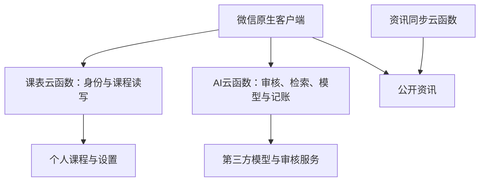

# 技术附录：冻结源码与页面结构

源码：`95997fd41a0280ae90871dc3c9ae0ad5f841509e`。节选从该Git对象读取；完整实现以包内源代码为准。

## 系统职责与数据去向



临时文件和内存草稿不等于正式课程。架构图表示代码职责，不证明服务持续可用或已取得新的独立效果。

## 当前页面结构

| 页面 | 路由 |
| --- | --- |
| 岭南小栈 | `pages/home/index` |
| 学生部门 | `pages/departments/index` |
| 部门详情 | `pages/departments/detail/index` |
| 我的课表 | `pages/timetable/index` |
| 导入课表 | `pages/timetable/import/index` |
| 课程信息 | `pages/timetable/edit/index` |
| 课表设置 | `pages/timetable/settings/index` |
| 课程管理 | `pages/timetable/manage/index` |
| 校园动态 | `pages/news/index` |
| 资讯详情 | `pages/news/detail/index` |
| 目标日 | `pages/goals/index` |
| 目标日 | `pages/goals/edit/index` |
| 校历与考试 | `pages/calendar/index` |
| 体测估算 | `pages/fitness/index` |
| 升学与实习问答 | `pages/advancement/index` |
| 项目讲解与答辩练习 | `pages/defense/index` |

## 关键代码：miniprogram/pages/timetable/index.ts
冻结源码第542行起，节选。

```ts
  confirmChange() {
    const pending = this.data.pendingChange;
    if (pending === null) return;
    const change = pending;
    wx.showModal({
      title: '确认课表变更',
      content: change.content,
      confirmText: change.action === 'add' ? '添加' : '修改',
      success: (result) => {
        if (result.confirm) return this.applyChange(change);
        this.setData({
          pendingChange: null,
          assistantMessages: this.data.assistantMessages.concat([{ role: 'assistant', text: '已取消这次改动，课表没有变化。' }]),
        });
      },
    });
  },
```

## 关键代码：cloudfunctions/timetable/index.ts
冻结源码第537行起，节选。

```ts
  const context = cloud.getWXContext();
  const openid = typeof context.OPENID === 'string' ? context.OPENID : '';
  if (openid === '') {
    return { ok: false, error: '未能获取微信身份（openid），无法读写个人课表' };
  }
  const action = typeof event.action === 'string' ? event.action : '';
```
