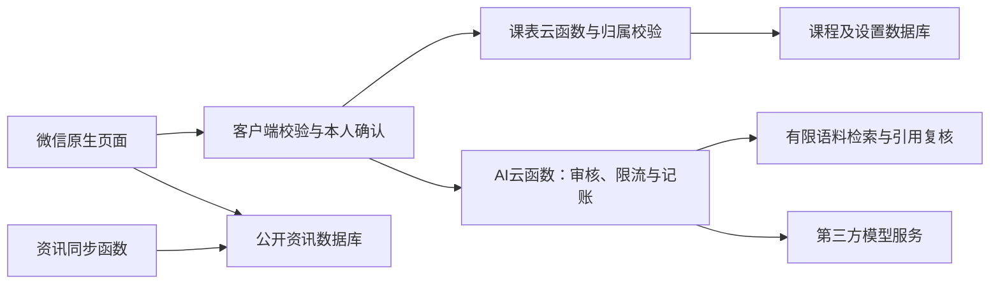

# 课表小栈作品说明：2026-10-29 候选修订稿

本轮补充：[新12题](../evidence/fresh-department-2026-10-29-round2/README.md)实际2请求/1答案，模型30秒超时费用未知停止，独立效果未通过。默认/首页名称已同步源码，但[原生新标题复核](../evidence/fresh-department-2026-10-29-round2/name-visual-review.json)未通过；旧媒体不覆盖。第三方[公开条款](../product/commandcode-terms-2026-10-29.md)已读，账号及上游实际安排未推定。后文关于旧界面名称的说明保留历史，不代表源码仍未更新。

**内部候选材料，尚未满足正式提交条件。** 正式作品名为「课表小栈」，团队Inlux，C组三人。当前界面及旧媒体的工作名「校园工具」保留历史，后续录制前再同步对应版本。历史r6源码固定 `e389e6aa142512d38ed445c8ab379a3ac37b4f4a`；本文为当前修订说明，运行实绩同步至`b7ee5fb`及评委路径证据，最终交付须从合并后的明确版本重新冻结。本文更新不代表旧ZIP内容已更新。本稿基于[10月23日稿](submission-candidate-2026-10-23.md)更新负责人确认；原稿、r6及此前包不覆盖。当前人工信息及技术待答见[10月29日确认说明](owner-update-2026-10-29.md)。

| 交付字段 | 当前事实 |
| --- | --- |
| 名称 | 课表小栈（负责人2026-10-29确认）；正式包仍待媒体及其他交付前置 |
| 报名及团队 | Inlux，C组，广东岭南职业技术学院，3名成员；姓名已整理到本地受控副本，不复制手机号/邮箱；指导教师具体字段待补 |
| 提交方式 | 学校统一上报；校内节点负责人已掌握，具体截止/接收人/交接方式仍需登记在交付记录 |
| 当前性质 | 校园题材参赛原型，未宣称正式上线或学校正式服务 |
| 往届成果 | 无（负责人2026-10-29确认） |
| 最终媒体 | 新 UI 真机录屏尚未取得，旧动画不替代本版本实测 |

## a. 项目说明

项目面向校园题材中的学生信息查询和个人课表维护任务。公开信息入口包括学校简介、学生组织资料和官网资讯；个人工具包括课表、目标日、考试日期入口和体测参考估算。用户自行导入 Excel 或截图，不需要把教务账号密码交给小程序。

核心路径是：教务系统下载 Excel 后发送到微信聊天 → 在小程序选择文件，或选择课表截图 → 校对课程名、星期、周次、节次、教师和地点 → 确认保存 → 查看周课表、手工维护，或向课表助手查询并确认课程变更。导入草稿与已保存课表分开，放弃不应改动已有课程。

16条在用页面已有岭南风格原生实现，含完整七天课表、固定节次轴、晚间课程、管理入口及答辩材料查阅。新界面代码已合入，离线模拟器截图可说明界面；新版本真实业务和真机结果需分别补齐。当前未取得真实学生访谈或使用效果样本，所述任务来自产品设计与维护者验证，不冒充需求调研结论。

## b. 小程序与 AI 能力说明

| 已实现能力 | 业务作用 | 证据及限制 |
| --- | --- | --- |
| 微信原生页面、文件/图片选择、云开发 | 微信聊天选 Excel、图片上传、课程和设置读写、公开资讯读取 | 原生 TypeScript/WXML/WXSS；配置及实际云端版本单独核对 |
| 课表截图识别 | 多模态结果转换为可编辑课程草稿 | 负责人确认通过保留；真实三张图六字段准确率、清理与被测版本仍待原始记录归档 |
| 课表 AI 助手 | 查询本人课表，生成结构化课程变更提案 | 本人取消/确认后执行；10题明细与当前版本录屏另计；不代办成绩/选课 |
| 部门问答与动态检索 | 用随包组织资料和 bigram 检索来源条回答有限问题 | 标题不支持的信息不扩写；新14题已部分首评，11请求/10答案后审核超时费用未知停止，保留NO-GO；后续另冻新题 |
| 升学/实习问答 | 范围澄清、有限官方资料检索、原句与引用复核 | 最近真实回归模型4/8、≤8秒0/8；最终修复版尚缺新独立效果，不能称已达标 |
| 项目讲解与答辩练习 | 固定事实卡、三轮作答、复盘与重答 | 有真实首评及部分真机记录；人类二审已获负责人确认通过，详细记录待归档；未新增学生学习效果实测 |

AI 产品能力主要以截图识别和课表助手的业务贡献说明；使用 AI 编程工具不计作产品内 AI 能力。目标日、日期卡和体测是规则与来源工具。

AI 接口在服务端调用，第三方中转当前记录为 CommandCode；模型密钥由服务端环境注入。最近留存实测的审核提供方是第三方 openai 适配器，这是历史配置快照，现场必须重新核对；不能称已完成微信默认审核验收。课表助手会向第三方发送当前课表文字快照，截图亦有第三方处理链路，接收方、留存及删除边界见[数据使用说明](../product/data-usage.md)。

## c. 创新点说明

| 常见流程与问题 | 本项目的具体处理 | 可验证范围 |
| --- | --- | --- |
| 聊天回答与真实课程修改分离，用户还需手工转录 | 自然语言生成结构化提案，字段校验后由本人确认 | 对照取消前后课程不变、确认后只改指定字段；不是自治代操作 |
| 截图识别错误可能直接进入正式数据 | 先生成草稿，逐项校对后保存 | 用实际截图逐字段统计及校对记录验证；不预填识别准确率 |
| 问答仅给结论，适用年份与原文不清楚 | 展示资料范围及来源，不能核对时拒答或原文降级 | 原始模型答案和最终展示分别留存；降级不算模型成功 |
| 通用答辩反馈可能把计划当成已完成 | 根据事实卡区分已完成、待验证和计划 | 维护者样例用于机制验证，不证明学生学习提升或教师认可 |

上表为具体流程比较，尚无竞品用户研究、系统对照试验或商业化验证，不宣称首创、行业领先或效果优于所有通用 AI。

## d. 技术实现

本项补充：[系统结构、16页清单及四段关键代码讲解](technical-appendix-2026-10-23.md)、[包内运行与配置说明](runbook-candidate-2026-10-23.md)。图示提供PNG，代码从固定commit逐字提取；读者可在包内核对完整源码，不必先取得私有GitHub权限才能阅读这些说明。

个人课程和设置以云函数调用上下文确定归属。整份导入采用 staged 批次和 head 切换，减少多批写入中出现半份数据的风险。AI 变更仍需本人确认；客户端共享云调用有75秒兜底，不能将该失败阈值当作正常交互速度。

部门动态使用随包语料、字符二元组检索与服务端注入，不称向量语义检索。构建时从同一数据源生成客户端/云函数材料。升学回答附可信原句，无法核对时降级。用量元数据记录 token、估算金额和失败分类；旧4条空响应费用仍为未知、不补猜；负责人已按评委使用放行预算，沿用50元月限额。新调用须核对当前账目、审核和限额，遇新未知费用/记账故障停止；不再把旧费用无法追溯写成全局尚未放行。

源码结构、运行方式及部署边界以[包内运行与配置说明](runbook-candidate-2026-10-23.md)为阅读入口；完整仓库的[本地开发](../development/local-setup.md)与[云开发手册](../development/cloud/README.md)保留为详细参考。候选源码解压后使用 Node.js ≥22，执行 `npm ci --ignore-scripts`、`npm run typecheck`、`npm run build`，微信开发者工具导入 `dist/`。源码审查子包排除整个 tests 及真实课表夹具，不声称在该子包运行完整回归；767项回归在固定 commit 的完整仓库执行。

10月29日已完成三条云函数依赖随包部署：[最终回读](../evidence/closeout-2026-10-29/cloud-final-compare.json)37个根文件一致，[实际下载依赖扫描](../evidence/closeout-2026-10-29/downloaded-dependency-audit-final.json)0通告。旧远端安装未落实overrides的失败和10月23日差异保留历史，不再写成本轮未部署。配置继续第三方openai；函数部署、真实定时及真机分别验证。

## e. 成果展示

最新[评委路径验收](../evidence/judge-path-2026-10-29/README.md)已取得24/24通过、0 skipped，以及课表助手实际面板16.2秒返回且与课表一致；[原生清晰度/Excel复核](../evidence/closeout-2026-10-29/README.md)已通过。均不能替代独立效果或真机。下表中的10月17/23日截图与767项数字保留为历史证据，不冒充当前全部结果。

| 材料 | 已有结果 | 当前边界 |
| --- | --- | --- |
| 本轮源码回归 | 独立目录安装、typecheck及767/767测试通过；四份依赖审计0漏洞 | 离线结果；[本轮记录](../evidence/competition-closeout-2026-10-23/README.md) |
| 新 UI 画面 | 10月17日390px原生模拟器10项离线检查、30张截图；320px浏览器辅助8画面 | 历史离线夹具，非真实课程或现场模型；本轮初轮阻断保留；重启后390px原生离线10项通过、30张新截图，后续原生清晰度复核通过、Excel V8两步及评委路径24/24通过；均为模拟器，非真机 |
| 人工验收 | 既有A1–C1/归属确认保留；负责人10-29确认原始人工验收与人类二审通过 | 本次未附具体评审者、样例、设备/版本与文件索引，只补归档，不重做或虚构指标 |
| AI 评测 | 各轮真实模型结果、失败和降级记录已有留存 | 升学独立效果/时延仍未达标；部门14题首评11请求、10答案，审核超时费用未知后停止、3题未调用，保留NO-GO及本批后续仅回归；答辩人类二审通过确认不外推到新模型效果 |
| 视频 | v7/v8旧界面代码动画可解释历史流程 | 合成数据与固定业务响应；新界面最终真机视频未完成 |

截图入口：[本轮重启后30张原生离线截图及结果](../evidence/competition-closeout-2026-10-23/native-after-restart/report.json)；[10月17日历史UI证据](../evidence/lingnan-ui-2026-10-17/README.md)保留。录屏按[新脚本](demo-script-2026-10-23.md)执行；媒体附日期、版本、环境和数据性质。尚未取得的结果不补造。

## f. 历史说明与第三方来源

往届成果：无（负责人2026-10-29明确确认）。本项目开发中的原型迭代仍保留版本记录，不等同于复用往届赛事作品。

学校简介、组织与资讯保留[来源索引](../product/sources/README.md)，官网正文的再利用范围与学校确认。校徽已于10月16日由负责人告知取得校长使用许可，并选定官网盾形横版；这是已记录的具体范围，没有书面授权附件，不外推其他学校内容、学生数据或推广许可。

第三方依赖、锁文件和许可来源按实际说明。答辩事实卡区分自有材料与维护者原创情景；[G0来源许可账](../evidence/project-defense-g0/README.md)保留。真实课表夹具含个人信息，候选源码包排除整个 tests、私人 artifacts、生产密钥、访问令牌、依赖目录和生成dist。包路径过滤不等于自动证明所有内容已获许可。

## g. 落地规划

近期先完成新 UI 实际回归、原始证据归档与最终真机录屏，核清名称、历史及许可范围，按校内安排交学校统一上报并取得回执。体验版或正式上线作为可选加分路径，当前不自动认证、备案或发布。

后续小范围试用须取得相应许可和用户告知，明确第三方接收方、保存期限、删除方式及维护责任。可观察的指标包括导入完成率、校对时间、任务完成情况、错误反馈和再次使用意愿；目前尚无真实用户数、留存率、付费转化或商业闭环验证。

可持续性由服务成本、资料维护及异常处理组成；月度50元是既有内部上限，演示前仍需核对当前账单与用量，不把服务端估算当结算。现阶段不开展长期校园运营。失物招领后续、校园通知RAG/OCR及正式分享发布路径按原决定暂缓。

## 正式提交关口

名称、团队和往届成果已登记，原始人工验收/人类二审按负责人确认通过；仍需指导教师及交接字段、其他内容/数据使用范围、按已放行预算执行的独立模型效果与异常处理、人工原始记录索引、经负责人确认后制作的最终视频、最终包及学校回执。本稿不等于正式提交。
