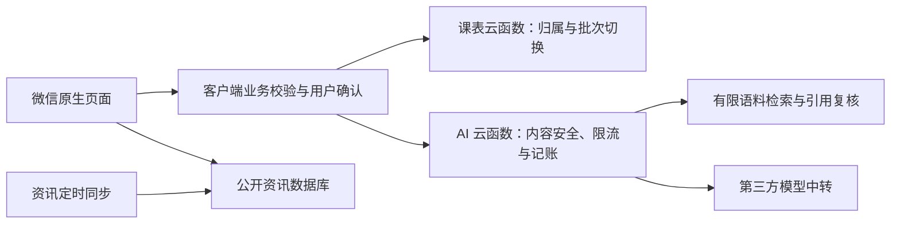

# 校园工具作品说明（2026-10-03 内部草稿）

> 2026-10-07入口说明：正文与同名PDF保留10-03的内部草稿快照。后续PR #131–#133已合入；当前校长审核材料使用[v6.5 PPT/PDF与v7代码动画](principal-2026-10-08/README.md)，最新模型效果及停止边界见[项目状态](../status.md)。正文中的v2.1、评测数字和源码审查包均按当时版本理解，不能作为最新材料或完整当前费用结论。

这是七项说明的 agent 完整稿，供负责人审核、补充事实后用于正式提交。工作名为「校园工具」，正式作品名、成员与指导教师、校内交接日期、往届成果核实和最终录屏尚待负责人提供。未取得学校授权、真实学生效果或赛事提交回执。当前实现与验收见[项目状态](../status.md)；本轮执行证据见[收尾记录](../evidence/agent-closeout-2026-10-03/README.md)。

## a. 项目说明

项目以广东岭南职业技术学院为校园题材，为学生提供校园信息和个人安排入口。用户可以查看学校及学生组织资料、阅读官网资讯，自行导入和维护课表，使用课表助手，以及查看目标日、登记的考试日期和体测参考估算。产品不代登教务系统，不采集教务账号密码，不提供学校管理后台。

主要流程为：从教务系统下载 Excel 后发送到微信聊天 → 选择文件导入，或选课表截图识别 → 人工校对课程、周次和节次 → 确认保存 → 查看周课表或向课表助手提问。课程变更以提案形式展示，取消不写库，确认后才执行。AI 不可用时，已有课表、部门资料和本机工具仍可使用。

项目已有负责人确认的人工验收结论及模拟器、云端和部分真机记录，证据按版本区分。当前没有真实学生需求访谈或使用效果样本，不能把维护者设计情景写成学生需求已验证。团队已确认 C 组报名及缴费，实际成员信息由负责人通过学校材料渠道填写，不从代码库推断。

10 月 8 日项目展示采用[12 页 v2.1 PPT 与 PDF](principal-2026-10-08/README.md)，按现有功能介绍；答辩练习的技术成果可作为补充材料，不自动替换负责人已确定的展示主体。

## b. 小程序与 AI 能力说明

小程序采用微信原生页面、TypeScript、WXML 和 WXSS；通过云开发云函数和数据库处理课表、AI 与公开资讯。模型密钥只配置在服务端环境，客户端不存储密钥。

| 能力 | 流程中的作用 | 人工或程序边界 |
| --- | --- | --- |
| 课表截图识别 | 图片转成可编辑的课程草稿 | 不识别的字段待核对，学生确认后保存；历史合成图成功不等于真实截图准确率 |
| 课表 AI 助手 | 自然语言查询与结构化变更提案 | 参数校验、范围控制、确认后执行，失败回到手工入口 |
| 部门问答与动态检索 | 已登记组织资料问答；按问题检索动态 | 动态只展示可核对的标题、官网发布时间和来源，不推断举办方或最新进度 |
| 升学与实习资料问答 | 范围确认、检索官方段落、模型选择完整原句 | 不支持的改写降级为原文；独立事实题效果及端到端时延本轮未达标 |
| 项目讲解与答辩练习 | 材料选择、三轮作答、复盘、重答 | 依据固定事实卡核对表述；维护者样例不证明教学效果或职业能力等级 |

目标日、日期卡和体测估算是规则与数据驱动的工具，不计为模型能力。各功能的接入、部署、效果分别见[状态](../status.md)。

本轮实测的 AI 内容安全提供方为第三方 `openai` 适配器，不能称为默认微信审核配置。文字、图片与课表内容的第三方接收方、处理地区、留存和删除条款仍按[数据使用说明](../product/data-usage.md)的待确认项管理。代码中的用户隔离、限额和记账不代表外部合同或学校许可已核实。

## c. 创新点说明

课表 AI 的结果进入可确认的业务提案，而非只展示聊天文字：课程字段和周次经过程序校验，学生可取消或确认。图片识别把不确定结果交回人工校对，避免错误直接写入正式课表。

知识问答将适用年份、地区、类型和引用原文作为回答前置。没有收录资料时澄清或拒答；引用身份与语义支持分开判断。部门动态只有标题级来源，本轮真实评测发现模型扩写举办方等事实后，客户端收紧为来源条目展示，保留原始模型回答供复核。

答辩练习围绕材料中的「已完成、未验证、计划」边界给反馈，保留事实编号和依据；G4 的维护者设计陷阱有实测记录。该机制展示的是对依据与表述的约束，当前不能宣称优于通用 AI 的教学效果，也不能宣称教师认可。

上述贡献针对具体流程。项目未进行竞品用户研究、增长实验或商业化试验，不以“首创”“行业领先”等无证据措辞作为创新结论。

## d. 技术实现

课表数据归属由云函数调用上下文确定，正式课程与设置在服务端读写。整份导入使用隐藏 staged 批次和 head 切换，避免多批写入过程中出现半份课表。AI 费用以服务端用量和月度汇总记录，记账失败时停止后续收费调用，相关取舍见[云开发手册](../development/cloud/README.md)。

部门动态采用 bigram 检索及 top-k 注入，语料由构建脚本从客户端资料导出到云函数，减少两份数据漂移。它是词面检索，不能声称具有完整语义召回。升学资料来自有限的版本化官方语料，服务端用可信段落核对输出，无法验证的回答不会作为官方结论展示。

客户端共享云调用有 75 秒兜底，晚到结果不会覆盖已结束调用；正常请求还受到平台和服务端预算约束。该阈值已通过本地测试，不能代替真机超时验收。

源码安装与验证：Node.js 22 或更高版本，执行 `npm ci --ignore-scripts`、`npm run docs:check`、`npm run typecheck`、`npm test`。`npm run build` 生成 `dist/`，微信开发者工具导入该目录。云环境与服务端密钥按[本地开发](../development/local-setup.md)和[部署关卡](../development/cloud/deployment.md)配置；构建不自动部署。审查包省略未脱敏的真实课表夹具，其原样本测试不在该包中复现，详见打包报告。

## e. 成果展示

可展示的成果包括 v2.1 项目 PPT/PDF、已入库的模拟器截图、答辩练习 G4 真机部分路径与部署回读记录，以及本轮逐题原始评测。截图标注版本、样例和环境；目标日是维护者自定义样例，体测是合成输入，不冒充真实用户成绩。

本轮升学冻结 14 题：守门 6/6，事实题 4/8 返回通过引用校验的模型答案；3 题引用闸降级，1 题检索拒答。7 次云请求均未满足端到端 8 秒门槛，因此不宣称独立效果或时延达标。全部成功输出还须逐句读原文复核，同一校验器复算不算独立事实验证。

部门固定 10 题完成真实云请求，但原始动态回答出现举办方等无依据扩写，已保存失败结果并增加输出边界。修复后的原响应重放属于回归，不冒充第二批独立模型评测。

答辩练习 G4 的 8 个维护者设计样例、AI 独立复核及部分真机路径见[证据](../evidence/project-defense-g4/README.md)。第二位人类评审、返回手势等缺口仍存在；不宣称真实学生学习效果、在线引用准确率或学校成绩。

最终版本的完整真机演示视频、真实学生反馈及提交回执尚无可用交付证据。现有历史界面讲解可用于准备材料，不勾选正式提交验收。

## f. 历史说明与第三方来源

本仓库已有多轮原型迭代、部署与验收记录。本次提交对应的代码版本、与往届赛事成果的关系及复用范围，必须由负责人核实后填写；当前不能擅自填写“无往届成果”。

学校简介、组织和资讯的来源见[来源索引](../product/sources/README.md)，公开可访问不代表学校背书或已获转载授权。AI 使用第三方中转，接口与计费配置不隐瞒。答辩事实卡区分自有材料与原创虚构情景，第三方素材许可登记见[G0 素材包](../evidence/project-defense-g0/README.md)。

第三方程序依赖及锁文件随审查源码包保留，安装所需许可按各依赖包核对。真实课表夹具含教师姓名与班级人数，审查包默认排除；不把原始数据、生产密钥、访问令牌、云存储个人文件或本地缓存打包交付。

## g. 落地规划

本阶段目标是稳定、可信的比赛演示。负责人确定正式名称、校内收口与交接方式后，再冻结材料版本和对应源码；现场只演示预先登记的路径，准备原文降级与失败话术，避免不限次数的现场 AI 提问用尽额度。

10 月 8 日沟通后，按实际取得的许可决定学校内容使用范围。真实学生试用、教师参与和推广需独立确认；目前不自动招募、不接教务系统、不开展长期校园运营。

增长方案是待验证计划：先提供可复现演示及经许可的小范围试用入口，围绕课表导入完成率、任务完成情况、错误反馈和是否愿意再次使用收集少量可核查记录；不虚构用户数、留存率或付费转化。尚无商业模式验证，后续需明确第三方数据条款、服务成本口径和维护责任，再决定是否扩展。

当前停用或暂缓的方向仍是失物招领后续、校园通知 RAG/OCR、正式发布分享路径。材料整理不等于批准这些功能或已经上线。

## 正式提交仍需负责人补充

正式作品名与成员信息；校内截止、接收人和交接方式；往届成果与授权事实；最终版本真机录屏；第二位人类评审及相关评价边界决定；演示审核配置；最终包审核和学校上报回执。以上均不由 agent 推断或编造。
