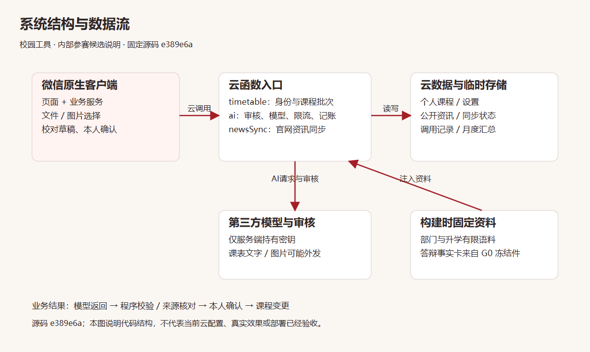
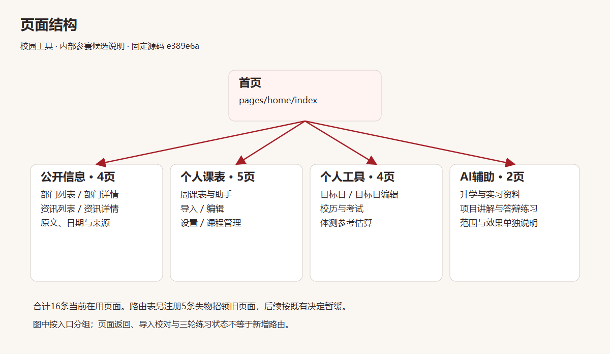

# 技术实现与页面结构补充

编写日期：2026-10-23。源码固定 `e389e6aa142512d38ed445c8ab379a3ac37b4f4a`，属于七项说明d项的补充。以下代码从该commit逐字提取；节选保留原行号，完整函数以包内源码为准。本轮没有改变业务实现。

## 系统结构



客户端负责呈现、输入校验和本人确认；课表云函数依据上下文身份读写本人数据，AI云函数统一处理模型、安全、限流和记账。资讯由独立函数同步，客户端仅读取公开内容。临时上传文件与正式课程分开；模型和审核密钥不进入小程序包。

图中是代码职责与数据去向，不能据此认为外部服务条款、当前部署版本或效果已经核实。实际配置与运行步骤见[包内运行说明](runbook-candidate-2026-10-23.md)。

## 页面结构



下表由固定commit的app.json及各页JSON核对：21条注册路由中，16条为当前在用页面，另5条为暂缓的失物招领旧路由。页面内的草稿、确认、失败、复盘等状态不额外计成页面数量。

| 页面标题 | 路由 | 代码入口 |
| --- | --- | --- |
| 校园工具 | `pages/home/index` | [页面源码](../../miniprogram/pages/home/index.ts) |
| 学生部门 | `pages/departments/index` | [页面源码](../../miniprogram/pages/departments/index.ts) |
| 部门详情 | `pages/departments/detail/index` | [页面源码](../../miniprogram/pages/departments/detail/index.ts) |
| 我的课表 | `pages/timetable/index` | [页面源码](../../miniprogram/pages/timetable/index.ts) |
| 导入课表 | `pages/timetable/import/index` | [页面源码](../../miniprogram/pages/timetable/import/index.ts) |
| 课程信息 | `pages/timetable/edit/index` | [页面源码](../../miniprogram/pages/timetable/edit/index.ts) |
| 课表设置 | `pages/timetable/settings/index` | [页面源码](../../miniprogram/pages/timetable/settings/index.ts) |
| 课程管理 | `pages/timetable/manage/index` | [页面源码](../../miniprogram/pages/timetable/manage/index.ts) |
| 校园动态 | `pages/news/index` | [页面源码](../../miniprogram/pages/news/index.ts) |
| 资讯详情 | `pages/news/detail/index` | [页面源码](../../miniprogram/pages/news/detail/index.ts) |
| 目标日 | `pages/goals/index` | [页面源码](../../miniprogram/pages/goals/index.ts) |
| 目标日 | `pages/goals/edit/index` | [页面源码](../../miniprogram/pages/goals/edit/index.ts) |
| 校历与考试 | `pages/calendar/index` | [页面源码](../../miniprogram/pages/calendar/index.ts) |
| 体测估算 | `pages/fitness/index` | [页面源码](../../miniprogram/pages/fitness/index.ts) |
| 升学与实习问答 | `pages/advancement/index` | [页面源码](../../miniprogram/pages/advancement/index.ts) |
| 项目讲解与答辩练习 | `pages/defense/index` | [页面源码](../../miniprogram/pages/defense/index.ts) |

## 1. 校对后才保存导入草稿

读取内存草稿，拦住缺少必要字段的课程，然后才调用saveDraft。解析成功不等于已保存；真实保存与临时文件清理仍需业务证据。

来源：[miniprogram/pages/timetable/import/index.ts](../../miniprogram/pages/timetable/import/index.ts)，固定commit第587–603行（节选）。

```ts
  confirmSave() {
    const draft = getDraft();
    if (draft === null || this.data.saving) return;
    if (this.data.blockedCount > 0) {
      wx.showModal({
        title: '还有待补全的课程',
        content: `有 ${this.data.blockedCount} 门课程缺少课程名、星期或节次，无法放进周课表。请修正或删除后再保存。`,
        showCancel: false,
      });
      return;
    }
    this.setData({ saving: true });
    return saveDraft(draft.courses, draft.meta.semester)
      .then((result) => {
        clearDraft();
        wx.showToast({ title: `已保存 ${result.saved} 门课程`, icon: 'success' });
        setTimeout(() => {
```

## 2. 模型变更由本人确认

只有确认分支调用applyChange，取消只清掉提案并显示未改动。后续applyChange复用既有createCourse/updateCourse，并保留未指定字段；代码约束不能替代本版本真实写库验证。

来源：[miniprogram/pages/timetable/index.ts](../../miniprogram/pages/timetable/index.ts)，固定commit第542–558行（节选）。

```ts
  confirmChange() {
    const pending = this.data.pendingChange;
    if (pending === null) return;
    const change = pending;
    wx.showModal({
      title: '确认课表变更',
      content: change.content,
      confirmText: change.action === 'add' ? '添加' : '修改',
      success: (result) => {
        if (result.confirm) return this.applyChange(change);
        this.setData({
          pendingChange: null,
          assistantMessages: this.data.assistantMessages.concat([{ role: 'assistant', text: '已取消这次改动，课表没有变化。' }]),
        });
      },
    });
  },
```

## 3. 从调用上下文取个人身份

身份来自cloud.getWXContext，不从客户端提交的owner获取；随后将同一身份传给各操作处理函数。归属验收保留负责人既有确认，原始版本及结果另归档。

来源：[cloudfunctions/timetable/index.ts](../../cloudfunctions/timetable/index.ts)，固定commit第536–545行（节选）。

```ts
export async function main(event: CloudEvent = {}) {
  const context = cloud.getWXContext();
  const openid = typeof context.OPENID === 'string' ? context.OPENID : '';
  if (openid === '') {
    return { ok: false, error: '未能获取微信身份（openid），无法读写个人课表' };
  }
  const action = typeof event.action === 'string' ? event.action : '';
  try {
    switch (action) {
      case 'prepareUpload':
```

## 4. 整份替换先写不可见批次

整批规范化通过后写入staged记录。后续用单个head文档切换activeBatch；旧批次清理失败仍按可见批次筛选。该方式不是多文档事务的承诺，异常回读及并发分支见完整源码。

来源：[cloudfunctions/timetable/index.ts](../../cloudfunctions/timetable/index.ts)，固定commit第348–372行（节选）。

```ts
  const records: Array<StoredCourse & { batch: string; staged: boolean }> = [];
  for (let index = 0; index < input.length; index += 1) {
    const normalized = normalizeCourseFields(input[index]);
    if (!normalized.ok) {
      // 整批拒绝：不做部分写入，学生修正后再保存。
      return { ok: false, error: `第 ${index + 1} 项无法保存：${normalized.error}` };
    }
    records.push({
      ...buildRecord(normalized.value, openid, sanitizeSemester(event.semester), makeCourseId(), String((input[index] as { rawText?: unknown }).rawText ?? ''), now, batch),
      staged: true,
    });
  }

  try {
    for (const record of records) {
      await db.collection(COLLECTION).add({ data: record });
    }
  } catch (error) {
    // 新批次尚未成为可见批次；即使清理失败，旧课表仍是唯一可见内容。
    const cleared = await removeWhere({ owner: openid, batch }).then(() => true, () => false);
    const message = error instanceof Error ? error.message : String(error);
    return { ok: false, error: `保存失败，${cleared ? '已清理未生效的新批次' : '未生效的新批次待清理'}：${message}` };
  }
  try {
    // 单文档提交可见批次；旧批次清理失败也不会混入列表。
```

## 难点与实际验证

| 难点 | 具体处理 | 目前证据与限制 |
| --- | --- | --- |
| Excel/截图的字段可能不完整 | 草稿可校对，缺必要字段阻止保存，支持手工维护 | 离线导入校对与网格检查已过；真实截图逐字段结果待归档 |
| AI提案可能误改课程 | 范围与字段校验、本人确认、修改只应用明确字段 | 本地回归及历史人工确认保留；当前版真实取消/确认记录另补 |
| 多批写入可能留下半份课表 | staged批次、head切换、可见条件及异常回读 | 完整逻辑测试已有；本轮未整份替换真实课表 |
| 知识回答可能越出资料 | 有限语料、来源条、原句核对、澄清/拒答与降级 | 升学最近真实回归4/8、≤8秒0/8；部门新14题未调用；不称已达标 |
| 费用与失败可能漏记 | 服务端调用记录、月汇总与停止关口 | 旧4条空响应费用仍待核账，真实调用未恢复 |

本轮原生模拟器10项离线交互通过、30张截图已归档；完整仓库767项测试及审查子包干净安装/构建是不同层次。全文与图示为技术说明，不增加真机、学校授权或独立模型效果宣称。
