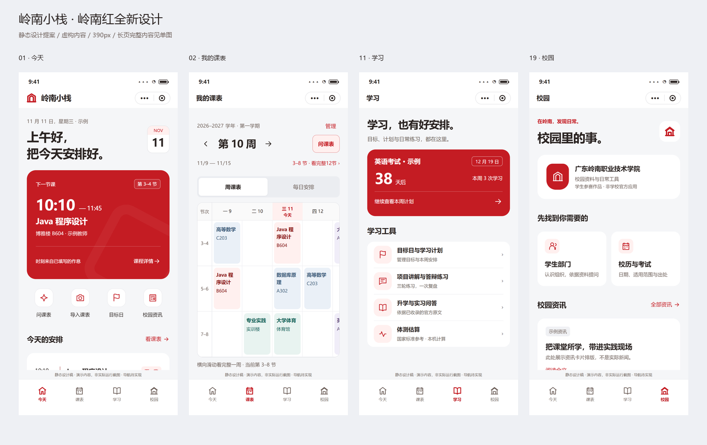

# 岭南小栈 · 岭南红全量 UI/UX 重设计

2026-11-11。状态：**独立静态评审已达8.5完成线；设计提案待定稿，新UI尚未实施。** 负责人最新要求「先画设计图」，先交付设计；达到完成线后，按此前授权提交并推送已完成的功能与设计稿。以前“保留首页布局”的决定不作为本轮设计限制。

2026-11-13续办：负责人明确本轮独立静态评审完成线为 **8.5/10**。按同一当前版本两份有效总体评分的最低值判定；旧版分数不混用，当前版本 LN-6c774710ba24831b 已取得8.5/8.6两份有效独立总体评分，最低值8.5达标；只代表静态设计意见。

[打开设计图册](review/index.htm) · [四个主入口总览](review/overview.png) · [画面与路由清单](screens.json) · [静态检查](review/checks.json)

跟踪：[Issue #147](https://github.com/Iskuyal/wx-match/issues/147)（`ready-for-human`，等待视觉定稿）。[评审与修订记录](review/revisions.md)保留每份原始意见，不以独立审美意见代替负责人确认。



## 简报与范围

面向岭南在校学生，在微信里快速查到下一节课、核对调课通知、为目标安排学习，并阅读有来源的校园资料。首个可见成果是「导入并核对课程后，今天和周课表出现自己的安排」。平台保持原生微信小程序 + TypeScript；课表导入制、数据契约、确认后写入与撤销等行为保持。交付为静态 HTML/PNG、任务路径、尺寸与状态说明，不接新后端，不调用真实 AI。

共 **79 张画面**：覆盖 `app.json` 的 **22 个页面路径**，其中 17 个在用、5 个失物招领暂缓路径；另提出「学习」「校园」两个聚合入口与四项底部导航。44–48、50 共六张失物招领稿仅作附录，不恢复正式入口。页面数不等于新增小程序路由数；同一路由的状态分别成稿。

## 基线、方向与取舍

基线为当前 `codex/review-ai-experience-20261110` 工作区：读取 `app.json`、全局样式、现有 WXML 和领域/规格；参考 [11-10 历史原生首页截图](../../evidence/ai-review-2026-11-10/01-home-before.png)。这张截图是历史基线，本轮没有捕获新的真实微信界面。修改影响面限定在设计文件；现有业务、路由和样式没有被本稿覆盖。

| 方向 | 构图与信息组织 | 取舍 |
| --- | --- | --- |
| **日程工具，红色聚焦（选用）** | 今天先看下一节课；四个稳定任务入口；内容页突出结果、来源和确认动作 | 高频任务容易扫读；新增聚合页与导航需要在实施时完成路由迁移 |
| 校园刊物 | 校徽、大标题、新闻与影像先行，工具藏于栏目 | 校园题材鲜明，但查课和计划仍要绕行，且依赖真实影像素材 |
| 对话主入口 | 首屏以对话为主，功能通过提问触达 | AI 最显眼，但用户不知道范围，弱网或额度不足时日常工具变难找 |

创作发散使用一次固定随机种子，仅存放于忽略的内部工作目录；人为联想到「连续日程与独立节点」。最终选择由学生查课、核对和保存的任务决定，不把随机串当成研究结论。

视觉主张：**把重要的时间留在视线里，把复杂动作拆成能核对的步骤。** 保留岭南红 `#c41c23`，用在下一节课、最近目标、主操作和当前导航；浅灰与白色分出阅读层次。移除大横幅、装饰印章、宋体大标题、全模块入口墙和未接入的语音按钮。新绘的小门楼线性符号是产品图形，不替代或重绘学校官方校徽；现有校徽资产仍保留。

## 视觉与平台契约

- 390px 设计宽度；主要正文 14–15px，字段 15px，标题 26–30px，行高 1.6–1.85；系统黑体回退 `PingFang SC` / `Microsoft YaHei`，无外部字体依赖。
- 边距 20px；320px 时 16px。控件高度 44–50px，主要触控目标按 44px 项目基线检查。节次轴固定，星期列 74px，在课表内部横向滚动；没有把七天文字压成微型格。
- 白色页面导航与微信胶囊保留独立空间。四个主入口画固定高度 844px 的滚动内容区与底部导航；其余长表单为展开阅读图；04/15/16/69/76采用可滚动内容与固定操作，替换范围紧邻保存。下方安全区只是设计占位，实装按设备测量，不照抄坐标。
- `_tokens.css` 的 16 个令牌与 `miniprogram/app.wxss` 同名同值；新提议的灰色表面、线条、半径写在 `_mockup.css`，尚未迁入生产令牌。样式提案与生产令牌逐项映射后再实施。
- 状态同时用文字与颜色表达；AI 约束草稿使用中性编号，用户确认前不打绿色“通过”勾。规则检查与模型理解的职责分开呈现。
- 课程、通知、体测、资讯、练习等均标明演示或虚构身份。学校/部门事实仅依据项目保存资料（2026-09-17/18），政策样例依据2026-10-03收录文件，明确未重新联网核查。资讯、校历、问答不把虚构内容冒充学校实际发布的信息；体测示例另与当前计算器核对。

## 导航方案

| 主入口 | 职责 | 当前或提议的实现位置 |
| --- | --- | --- |
| 今天 | 下一节课、今天安排、继续查看已保存计划 | 保留 `pages/home/index` |
| 课表 | 周 / 日安排、导入、课程、助手与独立学习计划 | 保留 `pages/timetable/index` 及子页 |
| 学习 | 目标日、学习计划、答辩练习、升学问答、体测 | **提议新增** `pages/study/index` |
| 校园 | 部门、资讯、校历、学校简介及来源 | **提议新增** `pages/campus/index` |

当前项目没有 `tabBar`，本稿只是新导航方案。实施时要同步普通页面到 tab 页的跳转、原有深链、分享回流与返回行为；不能只画底栏而继续用错误的页面栈。主入口不画返回箭头，普通任务页保留返回；详情从分享进入时须保留回首页/校园路径。

## 任务、结果与恢复

| 任务 | 分镜与可见成果 | 高影响分支 / 实施契约 |
| --- | --- | --- |
| 今天与时间依据 | 01；未知作息 53；无课表 36 | 只用本人已填作息判断下一节；读取失败不说“今天没课” |
| 导入课表 | Excel：03 → 76 → 68 → 69 → 02；截图：03 → 04 → 75 → 69 → 02；其他课程修正见79 | 38 识别失败可换文件/手工；确认替换时明确覆盖手工修改；阻塞字段未补齐时不得保存 |
| 查课、编辑与删除 | 02 / 67 → 66 → 05；07 管理 | 06 设置；51 完整十二节、周末长标题；52 字段错误；41 删除确认不可撤销 |
| 通知限定周次调课 | 08 → 09 → 70 → 09 → 10 → 71；72 撤销 | 09 原文、前后差异、仅第11周、其他周不变；10 限时撤销；39 部分成功只重试失败项 |
| 目标日 | 12 → 13 → 12；54 → 55 | 本机保存；删除目标后历史计划仍可回看，不自动新建目标 |
| AI 学习计划 | 14 → 15 → 16 → 17 → 02 | 原话依据 → 用户核对 → 规则预览 → 保存；18 新冲突；40 过期/目标删除；43 额度不足；49 基础规则；64 约束未理解时阻止直接排程 |
| 部门与问答 | 20 → 21 → 65；22 资料不足 | 回答与来源并列，不补猜联系/招新/校区；无答案仍可读资料 |
| 资讯与校历 | 23 → 24；25 | 来源、日期、范围不隐藏；日期待公布独立表达；刷新失败保留旧内容、首次失败给重试，按 37 恢复组件复用 |
| 体测 | 26 → 27 | 63 缺项不报学年总分；本机计算，不保存；国家参考与学校成绩区分 |
| 升学与实习 | 28 → 29 → 30 | 先澄清范围；AI 解释与原文分开；无出处时退回原文，不判断录取资格 |
| 答辩练习 | 31 → 32 / 33 → 34 → 56 → 57 → 58 → 59 → 35 → 60 → 61 | 42 材料；77/78为主动复制现有记录的新增交互提案，未执行真实剪贴板写入；三轮、一次重答；33 停止等待保留回答；62 退出前说明会话清空 |
| 暂缓失物招领 | 44–48、50 附录 | 发布、认领、发布者审核与交接分开；不新增 AI 匹配，不恢复入口 |

同一页从不同状态打开的材料弹层与退出确认，在实际实现中返回**触发它的状态**并保留草稿。静态文件中的返回链接只能表达一个示例上下文，不能证明动态上下文保存。识别等待、提交中与成功等自动过渡由分镜顺序说明，不用 JavaScript 伪造业务。

## 验证与复现

```powershell
node docs/design/lingnan-red-2026-11-11/generate.mjs
node scripts/render-mockups.mjs docs/design/lingnan-red-2026-11-11 --height 844 --check-overflow
python -X utf8 docs/design/lingnan-red-2026-11-11/verify-design.py
python -X utf8 docs/design/lingnan-red-2026-11-11/package-review.py
npm run docs:check
```

检查范围：390px / 320px 渲染、横向溢出、文本裁切、静态链接、44px 目标、课程局部滚动、语义色对比、路由覆盖与体测示例。独立评审保存当前截图内容指纹、原始意见与修订；只评静态设计，不宣称评委满意、用户研究通过、真实微信交互或真机验收。

## 待定稿内容

负责人看 PNG 决定视觉方向、四项导航与两处聚合入口是否作为实现依据。确认前保持提案身份；本轮不修改 WXML/WXSS、不部署、不请求真实 AI、不上传体验版。实施仍需验证小程序安全区、系统字号、键盘、读屏、页面栈、输入恢复与真实保存。
