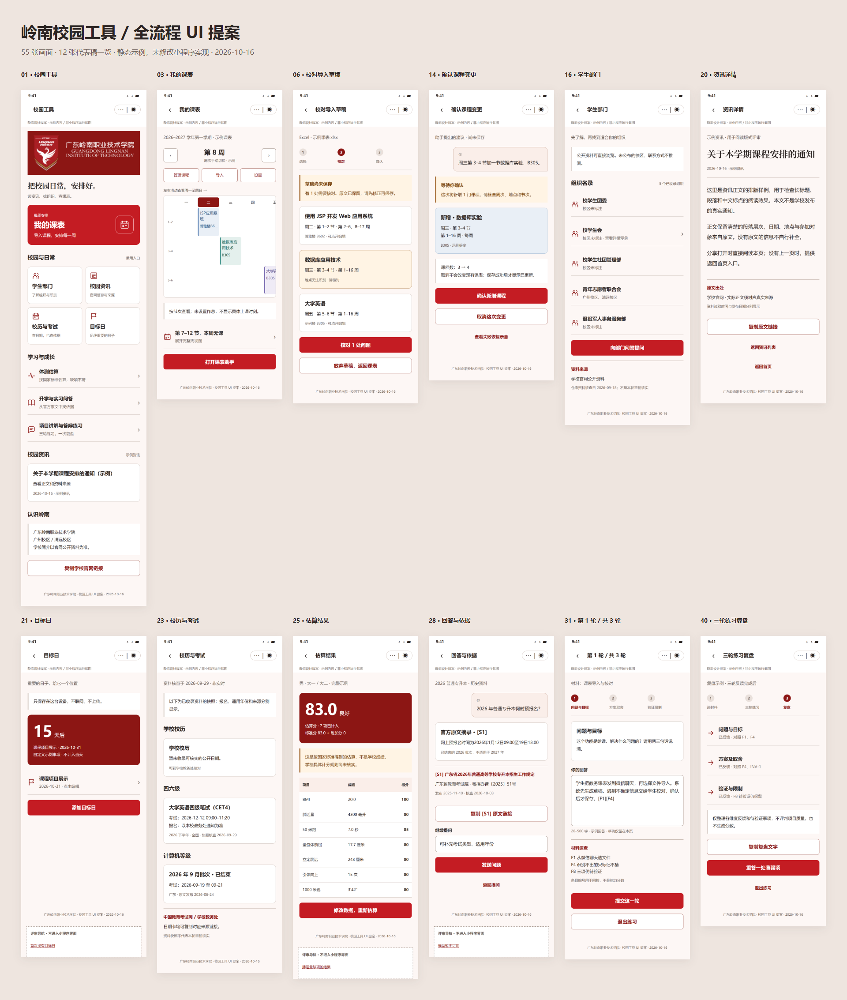

# 岭南校园工具 · 全流程 UI 设计提案

日期：2026-10-16。状态：**本地 55 屏修订稿待负责人评审；Figma 为 44 屏初稿，额度受限，尚未同步修订。未改小程序实现。**

跟踪任务：[Issue #135](https://github.com/Iskuyal/wx-match/issues/135)。保留为待负责人评审和远端同步，不关闭既有设计或验收任务。

[总览图](review/overview.png) · [从首页开始浏览静态稿](01-home.html) · [Figma 初稿](https://www.figma.com/design/rZS8zZHE1euLlZzuVGxvOH) · [校徽来源与许可记录](assets/README.md) · [本地检查](review/checks.json) · [第一轮原始评审](review/round-1.md)



## 简报与设计范围

面向广东岭南职业技术学院普通学生，在微信中快速进入课表、校园资料和日常工具。第一份可见成果是“导入课表 → 校对草稿 → 确认保存后看到课程”；其他任务各自保留入口、结果、返回和适用的恢复状态。交付是 HTML、PNG、任务契约和 Figma 初稿，不接入新后端，不触发真实业务模型，不把设计图当成小程序截图。

基线为 `main@40513b2`：本轮先提交并推送原有 v8 演示材料，之后在 `codex/lingnan-ui-design` 进行设计。现有原生小程序 16 个在用页面路径、普通页面栈、数据和权限契约继续作为实现约束；失物招领仍暂缓。首轮 44 屏和评审输入已保存在 `e44588e`，第二轮修订不改写该历史。改版前只读取了当前 WXML/WXSS、路由和标明合成身份的旧演示图，没有本轮真实客户端基线截图。

## 方向与取舍

| 方向 | 信息组织 | 取舍 |
| --- | --- | --- |
| 校园手册（选用） | 校徽、短标题、课表主动作；日常入口分组；正文与出处分开 | 适合已有工具和来源阅读，不需要增加个人数据或推荐能力 |
| 个性化智能仪表盘 | 实时课程、提醒与推荐聚合 | 当前首页没有这些读取契约，容易把视觉稿变成新增功能承诺 |
| 校园影像导览 | 大幅校园摄影、故事与活动 | 更适合介绍和招新；会压低高频工具入口，且需另核图片来源 |

本稿用“把校园日常，安排好”组织内容。首页以校徽和短宋体标题建立学校辨识度；工作页使用黑体、直接字段和明确确认动作。没有真实学生研究，这些取舍属于设计判断。

## 品牌、字体与尺寸

- 负责人已选择官网 **EST.2001 盾形横版**：[官方 PNG](https://lnc.edu.cn/upload/main/site/logo/image/632c5c3010a646af860c8fd0e86df405.png)。保留透明度、原始比例与字样，在深红底上使用。2021 年公告中的门楼版 JPG 仅作历史来源参考；Figma 仍是该旧版，待同步。
- 语义色沿用生产 `app.wxss`：主动作 `#c41c23`、深红 `#8c1614`、暖纸白 `#fdf7f5`、正文 `#2b2422`、次级文字 `#6b5d57`。`_tokens.css` 仅保留生产中同名同值的令牌，没有提前修改生产样式。白色表面、分隔线及状态衍生色写在静态稿 CSS，合入实现前再决定生产令牌。
- 中文界面使用系统黑体：`-apple-system`、`PingFang SC`、`Microsoft YaHei`；首页与资讯标题回退至宋体。Figma 使用可用的 Noto Sans SC / Noto Serif SC，并非字体像素完全一致的证明。未加载外部字体。
- 标准画布 390px，侧边距 20px，普通字号 13–16px；主操作至少 48px，次级操作至少 44px。320px 单独渲染检查；小程序实现需按实际点击范围、安全区和胶囊测量适配，不照抄静态状态栏位置。
- 周课表按节次显示；成对节次高度 87.36px 对应现有每节 84rpx 的两节高度。修订稿改为固定 66px 星期列和局部横向滚动，不再按空课日改变列宽。常规画面只展开有课的前六节，并明确给出剩余节次入口；55 展示完整 12 节及七天有课的压力样例。这是待评审的视觉提案，现有实现未变化。

## 主要任务与契约

| 任务 | 入口 → 可见成果 | 当前页面路径 | 取消 / 返回 / 失败 |
| --- | --- | --- | --- |
| 首页 | 01 → 各独立任务 | `pages/home/index` | 公共资料不要求先填账号；无 tabBar |
| 导入课表 | 02/03 → 05 → 06/07 → 08 → 09 → 03 | `pages/timetable/import/index`、`edit/index`、`timetable/index` | Excel 从微信聊天选取；识别不猜；草稿不写库；替换必须确认；49 失败可重试、Excel 或手工录入 |
| 查课与编辑 | 03 → 04 / 10 / 11 / 12 | `pages/timetable/index`、`edit/index`、`manage/index`、`settings/index` | 50 输入错误靠近字段；保存失败留输入；删除 36 → 44；取消不变更；未核实时刻不预置 |
| 课表助手 | 03 → 13 → 14 → 43 | `pages/timetable/index` 内对话 | 14 取消回 13；未确认不改课表；15、45、46 区分模型、安全、额度问题；手工入口始终可用 |
| 学生部门 | 16 → 17 → 18 | `pages/departments/index`、`detail/index` | 以学生会作详情样例，其余组织复用结构；缺失校区/联系方式如实显示；问答保留问题，返回可读资料 |
| 校园资讯 | 19 → 20 → 35 | `pages/news/index`、`detail/index` | 来源只复制链接；分享进入详情有回首页；34 保留旧内容，48 首次无数据分别成屏 |
| 目标日 | 21/47 → 22 → 21 | `pages/goals/index`、`edit/index` | 仅本机保存；取消不写入；51 单独确认删除 → 47；日期示例固定为 2026-10-16 |
| 校历与考试 | 01 → 23 → 来源 | `pages/calendar/index` | 使用仓库 2026-09-29 资料快照，学校日期缺失时不推测；报名和考试分别显示，历史批次不倒计时 |
| 体测估算 | 24 → 25 / 26 | `pages/fitness/index` | 国家标准参考估算，不是学校成绩；不上传不保存；缺项不给总分；示例 83.0 沿用既有完整夹具 |
| 升学问答 | 27 → 28 / 29 | `pages/advancement/index` | 标明适用年份、发布主体、核查日；继续提问有发送动作；解释失败仍可读原文，不判断录取资格 |
| 答辩练习 | 30 → 31/32/33 → 39/53 → 52/54 → 40 → 41 → 42 | `pages/defense/index` 内状态 | 三轮、一次复盘、一次重答；32 停止等待保稿；38 失败不推进轮次；37 退出清空会话需确认；不输出能力等级 |

所有本地链接只跳转到预先画好的状态，不会真的上传、保存、删数据、生成答案或写剪贴板。表单是静态字段图形，未实现输入。识别等待的成功/失败、复盘等评审分支放在手机页面下方虚线框内，并标明“不进入小程序界面”。同类对象的详情仅提供代表性样例，不能把示例跳转当成动态路由实现。

## 图稿索引

标准稿在 `png/`，源文件为同编号 HTML；320px 稿在 `review/narrow/`。

| 编号 | 页面 / 状态 |
| --- | --- |
| 01 | 首页与全部在用工具入口 |
| 02–04 | 课表空态、周课表、课程详情 |
| 05–09 | 导入方式、Excel 草稿、截图等待、校对、整份替换确认 |
| 10–15 | 手工编辑、管理、设置、助手查询、改课确认、模型失败 |
| 16–20 | 部门名录、详情、部门问答、资讯列表、阅读详情 |
| 21–23 | 目标日、目标编辑、校历与考试 |
| 24–29 | 体测输入/完整/缺项、升学入口/依据/降级 |
| 30–33 | 答辩材料、第一轮作答、等待、反馈 |
| 34–38 | 资讯刷新失败、复制反馈、课程删除、练习退出、练习失败 |
| 39–44 | 第二轮、复盘、重答、收尾、改课成功、删除成功 |
| 45–51 | 助手安全/额度、目标空态、资讯空态、导入失败、字段错误、目标删除 |
| 52–54 | 第三轮作答、第二轮反馈、第三轮反馈 |
| 55 | 七天有课、长课程名、完整十二节的压力样例 |

## Figma 已保存内容与未完成项

初稿文件：[岭南校园工具 · 全流程 UI 设计](https://www.figma.com/design/rZS8zZHE1euLlZzuVGxvOH)。[节点与状态记录](figma/state.json)保留 44 张画面的节点 ID、24 个变量、42 个字体样式及创建记录。组件覆盖按钮变体、内容卡片、字段和来源；界面由原生文本、自动布局、实例和向量图标组成，仅官方校徽使用原始位图，没有把整屏 PNG 当作 Figma 设计。

Starter MCP 调用上限已实际触发，`whoami` 复核后重试也被拒绝，未升级套餐。以下保持未完成：

1. 把最终 55 屏修订及用户选定的盾形校徽同步到 Figma。
2. 清理初稿封面占位区并复核基础区与主画布排布；这些区域可能重叠。
3. 获取其余画面截图并完成整套远端视觉复核；现仅有初稿 01、03、31 三张截图。
4. 连接并实际检查 Figma 原型热区。现有本地静态跳转不证明远端原型可用。

因此**本地修订 PNG/HTML 是本轮的评审依据；Figma 是保留中的初稿**。不能把三张 Figma 截图外推为全部远端通过，不能把本地修订写成已同步。

## 验证与复现

```powershell
node docs/design/lingnan-ui-2026/generate-html.mjs
node scripts/render-mockups.mjs docs/design/lingnan-ui-2026
python -X utf8 docs/design/lingnan-ui-2026/verify-design.py
npm run docs:check
```

静态检查覆盖 55 × 2 个视口（390px / 320px）、12 条画面跳转链、7 组正文对比色；检查没有页面横向溢出、断链、缺失图片或小于项目 44px 目标的链接。周课表在内部滚动容器里保留二维布局，课程名最多三行、地点可省略，完整信息由详情设计承接。检查报告不等于完整无障碍审计。

第一轮独立评审原文与输入清单分别见 [反馈](review/round-1.md)和[原清单](review/round-1-manifest.json)，输入源图已保存于 `e44588e`；第二轮按当前清单另做全新上下文评审。评分只是静态设计意见，不作为用户研究、学习效果或真机证据。未验证微信客户端、真实模型、云端保存、真实文件上传、剪贴板、读屏及系统字号适配。

## 待负责人评审

评审当前 55 屏的任务组织、盾形校徽尺寸、周课表横向查看和空课时收起方式。接受后再定稿并进入 WXML/WXSS 实现；本轮没有替代此前目标日、校历、体测等设计票的负责人决定，也没有关闭任何效果或真机验收项。
