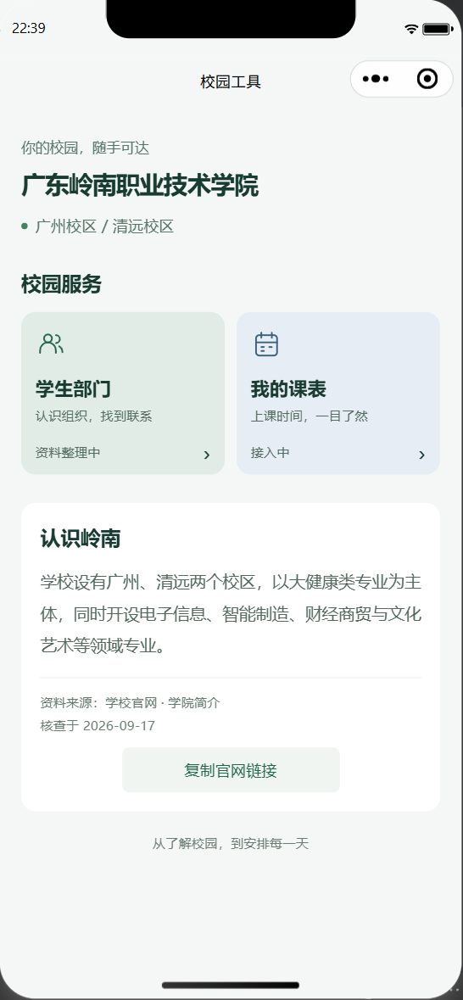
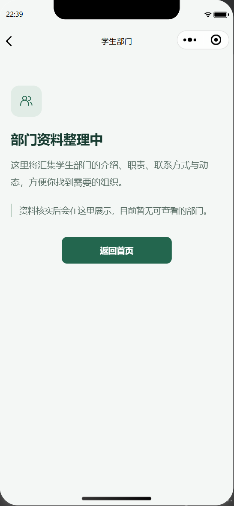
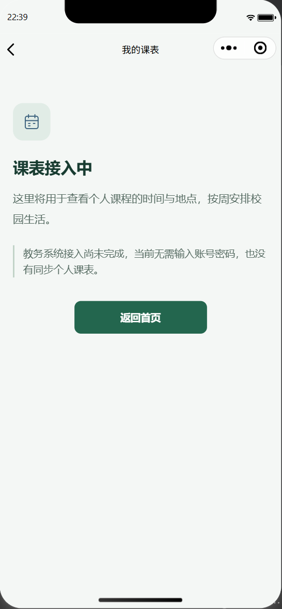

# P1 验证记录

日期：2026-09-17。状态：首页与入口完成开发者工具验收，尚未真机验证。

## 环境

- Windows，Node.js 24.16.0，npm 11.17.0。
- 微信开发者工具 2.02.2608070；游客 AppID；基础库 3.17.2。
- 模拟设备：iPhone 12/13 (Pro)，390 × 844 逻辑尺寸。
- TypeScript 5.9.3，微信 API 类型 5.2.3；自动化 SDK 0.12.1。

## 结果

- `npm run typecheck`：通过。
- `npm test`：构建和 4 项 Node 测试通过（3 项页面行为、1 项旧产物清理）；行为测试先在缺少实现时失败，旧产物测试先复现审查发现的问题，再修复通过。
- `npm run verify:wechat`：真实开发者工具中的学校名称、两个入口点击及返回、直接打开课表状态页后返回首页均通过。
- 来源复制成功/失败反馈由 Node 测试覆盖，未宣称已完成微信真机剪贴板验证。
- 截图检查：首页简介、入口、来源可读；两个状态页没有虚构部门、个人课表或账号表单。

原始自动化结果见 [verification.json](verification.json)。

## 截图

| 首页 | 学生部门 | 我的课表 |
| --- | --- | --- |
|  |  |  |

## 未覆盖与工具限制

真实 AppID、微信真机预览、上线审核、后端、教务接入及 AI 均不属于本次已完成成果。GitHub Actions 配置已提供，其远端执行结果需在推送后查看。

自动化 SDK 原有图像依赖含高危与严重级别审计项，已通过兼容 Jimp override 消除；目前 npm audit 仍报告 file-type 路径上的中等级别问题。此开发依赖只处理本机模拟器截图，不进入小程序产物；未使用强制降级 SDK 规避审计报告。后续升级需重跑截图验证。
