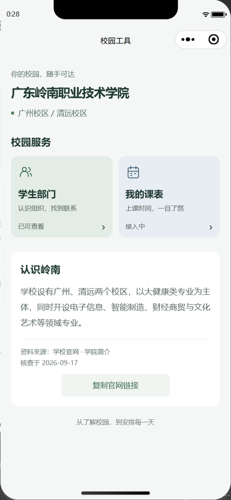
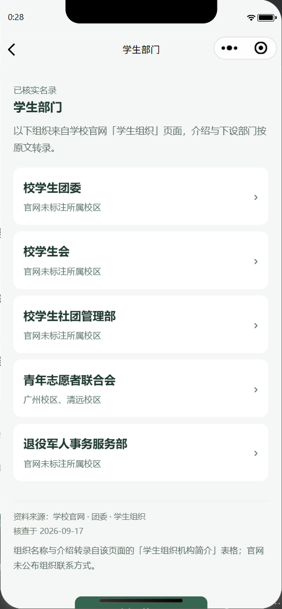
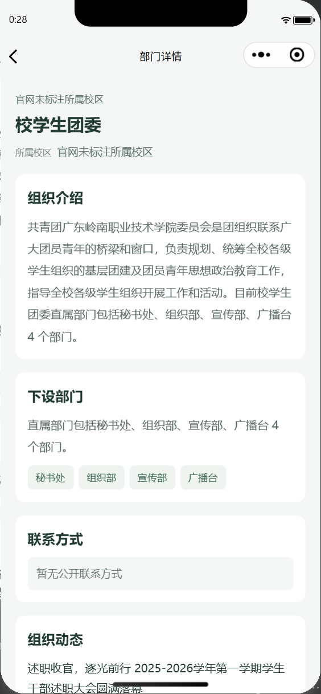
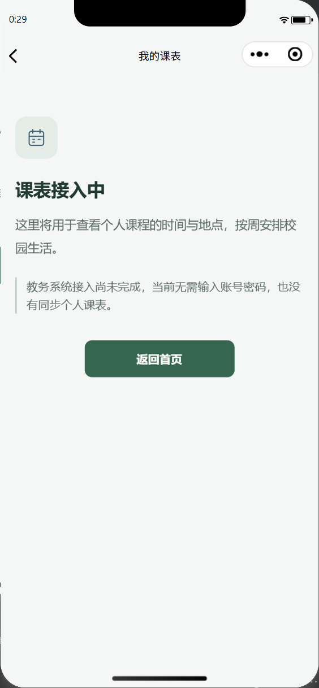
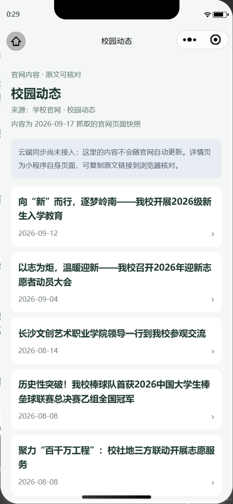
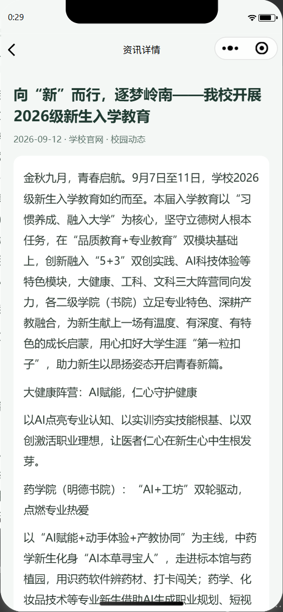

# P2 / P3 验证记录

日期：2026-09-18。状态：学生部门（P2）与资讯栏目（P3，不含云端同步）已在真实微信开发者工具中通过点击验收；真机、云环境与云函数未验证。

## 环境

- Windows，Node.js 24.16.0。
- 微信开发者工具 2.02.2608070；使用项目真实 AppID（见根目录 `project.config.json`），非游客模式。
- 基础库 3.17.2；模拟设备 iPhone 12/13 (Pro)。
- 自动化 SDK 0.12.1；TypeScript 5.9.3。

## 步骤

```powershell
npm test                                        # 构建 + 38 项 Node 测试
& 'D:\微信web开发者工具\cli.bat' auto --project 'F:\VibeCoding\wx-match\dist' --auto-port 9420 --trust-project
npm run verify:wechat                           # 真实开发者工具中的点击验收
```

## 结果

- `npm run typecheck`：通过。
- `npm test`：38 项全过（P1 原有 4 项、部门 10 项、资讯 26 项中经合并后的全部用例，含 WXSS 结构与产物模块引用两项构建守卫）。
- `npm run verify:wechat`：10 项检查全部通过，原始结果见 [verification.json](verification.json)。
  1. 首页显示学校正式名称；
  2. 学生部门入口进入列表并可返回；
  3. 部门列表显示组织名称与所属校区（缺失时显示缺失文案）；
  4. 部门详情显示介绍、联系方式或缺失说明、动态或缺失说明；
  5. 未知部门 id 显示未找到状态；
  6. 课表入口进入状态页并可返回；
  7. 直接进入部门列表后返回首页；
  8. 直接进入课表状态页后返回首页；
  9. 资讯列表显示条目与标题；
  10. 资讯详情显示标题、正文段落与「复制原文链接」入口。

## 截图

| 首页 | 学生部门 | 部门详情 |
| --- | --- | --- |
|  |  |  |

| 课表状态页 | 资讯列表 | 资讯详情 |
| --- | --- | --- |
|  |  |  |

截图核对：部门列表只出现在官网表格图片中核实的 5 个组织，4 个组织的校区显示「官网未标注所属校区」、青年志愿者联合会显示「广州校区、清远校区」，页面底部标注来源与核查日期 2026-09-17；资讯详情正文结尾没有编辑署名行（供稿/初审/复审/终审），来源与日期与原文一致。

## 本次验收中发现并修复的问题

1. **WXSS 注释提前闭合**：两个资讯页样式文件的注释里写了 `.status-*/`，其中 `*` 紧跟 `/` 构成 `*/`，注释在此提前结束，后续文字被当作样式内容，开发者工具报 `unexpected` 编译错误。已改写注释，并新增 `tests/wxss.test.cjs` 守卫（扫描全部 `.wxss`，检查注释是否提前闭合与花括号平衡）。
2. **目录形式的模块引用**：页面写的是 `import ... from '../../services/news'`，微信的模块解析不做 Node 式的目录 `index` 回退，运行时报 `module 'services/news.js' is not defined`。已写全为 `.../services/news/index`，并新增 `tests/miniprogram-modules.test.cjs` 守卫（按微信规则校验 `dist` 中每个 `require` 都能解析到具体文件）。

两个问题都只能在开发者工具中暴露：Node 不做 WXSS 编译，且 Node 会自动回退到目录 `index.js`。

## 工具注意事项

`npm run build` 会清空并重建整个 `dist`，开发者工具的增量编译（自动热重载）在连续重建后可能残留旧状态，表现为引用旧文件内容或报「文件存在却未定义」。此时用 `cli cache --clean compile --project <dist>` 清编译缓存并重新打开项目，强制一次全量编译即可。本次排查即由该现象引起。

## 未覆盖

- 真机预览与体验版：未执行，`realDevice: false`。
- 云端链路：AppID 与云环境关联、数据库读写权限、云函数部署与调用、每日定时同步均未验证，仓库内没有 `cloudfunctions/`。
- 资讯数据来源为随包快照（2026-09-17 抓取），不是云端同步结果；正文图片未随包提供，页面已注明以原文为准。
- 首页最近资讯入口属 P3-2，未开始。
- 自动化脚本对页面的断言基于元素选择器，不能替代人工对视觉与文案的复核。
