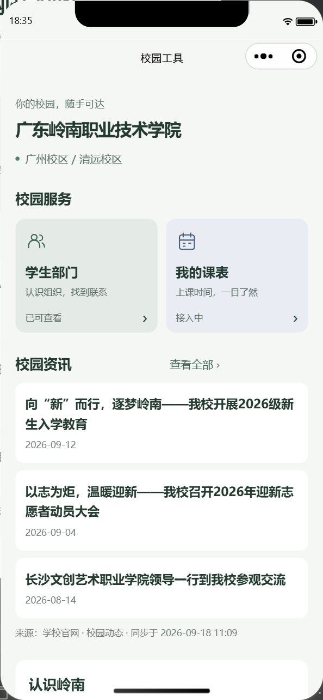
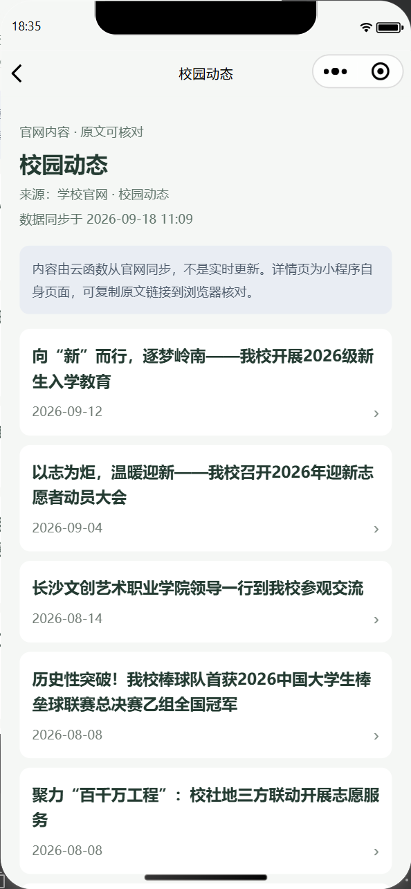

# Ticket 02 验证记录：首页资讯入口与列表逐页加载

日期：2026-09-18。状态：**已在真实微信开发者工具中通过点击验收**；真机与分页的实际多页场景未覆盖（原因见「未覆盖」）。

对应 [Ticket 02](../../tasks/tickets/02-home-news-entry-and-paging.md)、[P3-2 栏目同步与分页](../../tasks/p3-2-news-updates.md)。本目录只记录 Ticket 02 的范围，扩大抓取与每日定时属 Ticket 04，不在本文。

## 环境

- Windows，Node.js 24.16.0。
- 微信开发者工具 2.02.2608070；使用项目真实 AppID（见根目录 `project.config.json`），非游客模式。
- 基础库 3.17.2；模拟设备 iPhone 12/13 (Pro)。
- 数据源：云数据库 `news_articles`（环境 `cloudbase-d2gjtbbwu3575cd7b`），现有 10 条已同步记录；**没有引入随包静态快照**。

## 步骤

```powershell
npm test                                        # 构建 + 58 项 Node 测试
& 'D:\微信web开发者工具\cli.bat' auto --project '<仓库>/dist' --auto-port 9420 --trust-project
npm run verify:wechat                           # 真实开发者工具中的点击验收
```

## 结果

- `npm run typecheck`：通过（小程序与云函数两份配置）。
- `npm test`：58 项全过。本次新增 8 项：分页排序与 `skip` 起点、逐页追加与「已无更多」、加载失败保留已有条目并可重试、重叠条目不重复追加、首页最近资讯展示与入口、首页资讯读取失败可重试、详情页返回列表、正常状态的返回入口守卫。
- `npm run verify:wechat`：12 项检查全部通过，原始结果见 [verification.json](verification.json)。

本次新增并通过的 4 项检查：

1. 首页展示最近资讯并可进入资讯列表；
2. 资讯列表显示条目与分页页脚状态；
3. 资讯详情显示标题、正文段落与复制原文链接入口；
4. 列表与详情之间可往返。

## 截图

| 首页最近资讯 | 资讯列表 | 资讯详情 |
| --- | --- | --- |
|  |  |  |

截图核对：首页「校园资讯」区块展示 3 条真实标题与发布日期，与资讯列表首条一致；列表底部按数据量显示「已经到底了」或「上滑或点此加载更多」；详情正文与列表条目标题一致，底部有「返回」。

## 本次验收中发现并修复的问题

1. **正常状态缺少页内返回入口。** 资讯列表与详情页原本只在错误态与空态提供返回按钮；详情页在正常态没有返回入口，直接打开详情（分享或路径直达）且页面栈只有一页时，用户没有可点的返回方式。已按部门模块的既有写法补齐：列表页正常态加「返回首页」，详情页正常态加「返回」，并新增两处测试守卫。
2. **详情页返回文案与行为不符。** 补齐时一度写「返回资讯列表」，但详情既能从资讯列表进入，也能从本票新增的首页最近资讯入口进入——后者按 `navigateBack` 返回的是首页，文案会误导。已把文案改为「返回」，方法名从 `goBackToList` 改为 `goBack`，并加测试禁止再出现承诺回到列表的方法名。

## 已知边界（未覆盖）

- **分页的实际多页场景未在开发者工具中执行**：云端现有 10 条，小于单页 20 条，列表直接进入「已经到底了」。翻页逻辑（`skip` 起点、失败保留、重叠去重）由 `tests/news.test.cjs` 的桩测试覆盖；**开发者工具中只实测到末页状态**，未触发翻页、重试与空态。跑通真实多页要等扩大同步范围（Ticket 04）。
- **并发的插入或改期会让偏移漂移**：翻页期间若有同步写入新文章或更新文章日期，`skip` 的页边界随之移动，可能漏掉少量条目（重复条目已按 `id` 去重）。同步是手动或每日一次，与浏览重叠概率低；数据量扩大后如需更严格，可改为按 `(date, id)` 游标分页。
- **整页边界**：条目数恰为单页整数倍时会多发一次空请求并短暂显示「正在加载更早的资讯…」。不影响正确性。
- **组合排序索引未建**：分页查询按 `date` + `id` 倒序并带 `skip`，本次已在真实云数据库上实跑通过，但尚未建组合索引；数据量小无感知，扩大到 1252 条规模前应补建，见 [云开发文档](../../cloud-development.md)。
- 真机预览与体验版：未执行，`realDevice: false`。
- 未登录单页模式：仍被备案阻塞，由 [Ticket 08](../../tasks/tickets/08-post-publish-single-page-mode.md) 跟踪。
- 自动化脚本的断言基于元素选择器，不能替代人工对视觉与文案的复核。

## 工具注意事项（本次新增）

微信开发者工具的服务端口默认关闭，而 `cli.bat auto` 与 `miniprogram-automator` 都依赖它。本项目记录一条可复现的开启路径：关闭工具后，把用户数据目录下 `Default/` 内的 `.ide-status` 写为 `On`，并在 `WeappLocalData/localstorage_*.json`（`reduxPersist:settings`）中把 `security.enableServicePort` 置为 `true`，再用 `cli.bat auto ... --auto-port 9420` 启动。通过 GUI（设置 → 安全设置 → 服务端口）开启是官方路径，上述文件位置用于无人值守环境复现。
