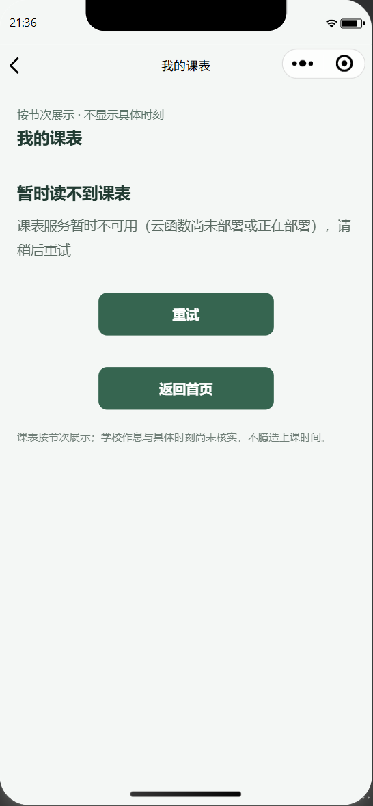
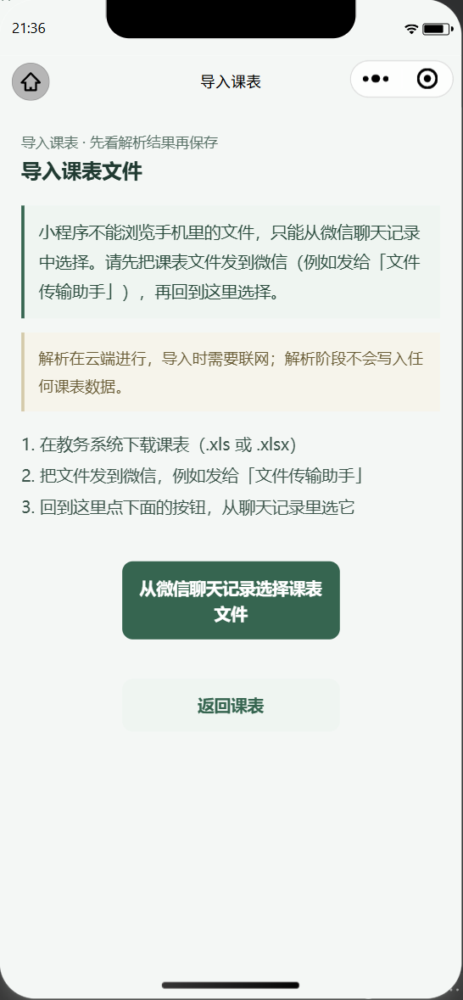
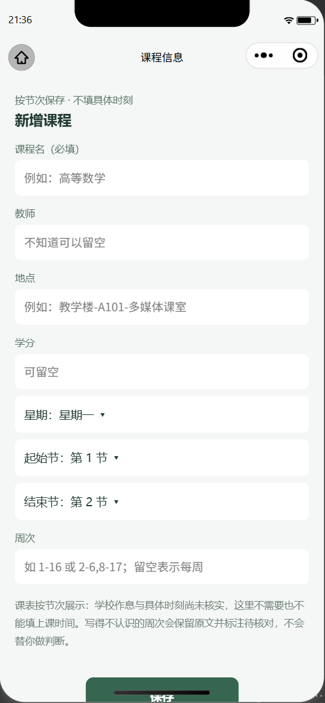

# Ticket 03 验证记录：课表 Excel 导入与周课表

日期：2026-09-18。状态：**代码与本地测试完成；云端未部署，端到端导入未实测**。分支 `feat/timetable-excel-import`。

对应 [Ticket 03](../../tasks/tickets/03-timetable-excel-import.md)、[开发规格](../../development-spec.md) 的「课表导入」一节、[云开发文档](../../cloud-development.md) 的「课表云端实施」。

## 环境

- Windows，Node.js 24.16.0；依赖 `xlsx@0.18.5` 只作为云函数依赖与本地测试依赖，不进小程序包。
- 微信开发者工具（模拟设备 iPhone 12/13 (Pro)，基础库 3.17.2），项目真实 AppID，导入的是 `dist/`。
- 样本：`tests/fixtures/timetable/` 的 4 份真实教务导出（标准版式、单换行多课、多课同格、另一班级）。

## 命令

```powershell
npm run typecheck    # 小程序与云函数两份 tsconfig
npm run build        # TS → dist，含 dist/cloudfunctions/timetable
npm test             # 构建 + 99 项 Node 测试（--test-concurrency=1）
& 'D:\微信web开发者工具\cli.bat' auto --project '<仓库>\dist' --auto-port 9420
npm run verify:wechat
```

## 结果

- `npm run typecheck`：通过，无错误输出。
- `npm run build`：通过，`dist/cloudfunctions/timetable/` 内含 `index.js`、`parse.js`、`record.js`、`types.js` 与 `package.json`。
- `npm test`：**101 项全过**。本票新增 43 项：
  - `tests/timetable-parse.test.cjs`（14 项）：4 份真实样本逐字段断言、跨大节去重、两种一格多课变体、行标识别不出时不按行序猜节次、节次倒置与越界只标记、周次写法不认识保留原文、**越界与倒置周次按「不认识」处理并与小程序侧判断一致**、**一份文件里多张课表只取第一张**、非课表矩阵与空文件、单节次写法；
  - `tests/timetable-flow.test.cjs`（9 项）：真实入口 + 云存储/数据库桩——导入不写库、临时文件删除、他人路径拒绝、跨学生隔离、整份替换、整批校验、手工三条路径；
  - `tests/timetable-view.test.cjs`（9 项）：节次与周次文案、按周筛选、大节落格、表单校验、草稿存储、小程序侧与云函数侧周次识别结果一致、错误文案映射、上传前本地校验；
  - `tests/timetable-pages.test.cjs`（10 项）：周课表主页周次切换与删除、导入页引导文案与「确认前不写库」、待补全条目的拦截、放弃导入不写数据、格式与解析失败的提示、编辑页三条来源（新增/修改/草稿修正）、模板不含具体时刻；
  - `tests/miniprogram-modules.test.cjs` 增补 1 项：**小程序产物不含 xlsx/SheetJS，解析器只在云函数产物里**（反向断言云函数声明了 `xlsx` 依赖）。
- `npm run verify:wechat`：**14 项检查通过**，原始结果见 [verification.json](verification.json)。其中与本票相关的 3 项：
  1. 课表入口与返回：周课表页显示标题「我的课表」，有导入或重试入口，不白屏；
  2. 导入页显示「只能从聊天记录选择、先发给文件传输助手」的引导与选择文件入口；
  3. 课程表单显示课程名、星期、起止节、周次与保存入口。

## 截图

| 周课表页（云函数未部署 → 错误态可重试） | 导入引导页 | 课程表单 |
| --- | --- | --- |
|  |  |  |

截图核对：周课表页在云函数未部署时给出「暂时读不到课表」+ 可理解的说明（云函数未部署的技术错误已映射成「课表服务暂时不可用（云函数尚未部署或正在部署），请稍后重试」，原始 errMsg 只打到控制台）+ 重试 + 返回首页，没有白屏；导入引导页把「小程序不能浏览手机里的文件，只能从微信聊天记录中选择……发给文件传输助手」放在首屏；课程表单按节次填写，并明确写出「不需要也不能填上课时间」。

产物核对：`dist` 内除 `cloudfunctions/` 外没有 xlsx/SheetJS 代码、也没有 `node_modules`/`miniprogram_npm`——这一条由 `tests/miniprogram-modules.test.cjs` 断言。**教师姓名不进小程序包是人工核对一次的结果**（用解析器从 4 份样本取出全部教师姓名，在 `dist` 内检索为 0 次），没有写成断言，因此不作为持续保证。

## 未覆盖（不计为通过）

- **端到端导入未实测**：`timetable` 云函数尚未部署（部署是负责人控制台操作，本票不代部署），因此「在聊天记录里选文件 → 上传 → 云端解析 → 确认 → 保存 → 周课表展示 → 周次切换 → 退出重进数据仍在」这一整条**真实链路没有在开发者工具中跑过**。开发者工具里目前只验证到：页面渲染、引导文案、表单与入口存在，以及云函数缺失时的错误态。
- **不同微信账号的隔离**：需要两个微信号与已部署的云函数，本地只由 `tests/timetable-flow.test.cjs` 的桩测试覆盖（两个 openid 互不可见、互不可改）。
- **文件选择无法自动化**：`wx.chooseMessageFile` 会打开微信聊天记录选择器，`miniprogram-automator` 不能操作系统弹层；本票的导入页测试以桩替换该接口。
- **未建索引、未验证大数据量**：个人课表数据量小，按 `owner` 全量读取；未建索引，也未验证超过 100 条的翻页读取（代码按 100 条一页循环读取）。
- 真机预览：未执行（`realDevice: false`）。
- 上传到云存储的真实过程（含存储权限拦截他人文件）未实测，只有桩测试与权限配置判据。
- **临时文件在极端路径下可能残留**：上传成功后若小程序被直接杀死（既没走到解析调用，也没走到失败清理），`timetable-imports/<openid 哈希>/` 下会留下一个约 20KB 的文件；云存储没有 TTL，当前只能靠下次导入或人工清理。影响面小，但确认页文案「临时文件在解析后已从云存储删除」在这种路径下不成立。

## 已知边界与决定

- **保存＝整份替换**：导入确认保存会替换本人全部课程（包括手工添加的课程），确认页文案已写明；手工课程在替换后需要重新添加。
- **周次未识别的课程按每周展示**：原文保留在 `weekText`，页面标注「待核对」；这是「只标记不猜」的直接后果，学生可在编辑页补全周次。
- **默认周次从第 1 周开始**：样本没有学期开始日期，学校校历未核实，因此不推断「当前是第几周」；页面默认第 1 周并允许切换（1 至 max(20, 数据中的最大周次)）。
- **相邻节次会被合并**：同一门课在同一星期相邻的两个节次区间（如 1-2 节与 3-4 节）合并为「第 1-4 节」一段，`tests/timetable-parse.test.cjs` 锁定该行为。
- **周次分隔符**：解析接受半角逗号、全角逗号与顿号；顿号是为手工表单里的「4-5、7-8」写法保留的，两侧解析器结果由测试对比锁定。
