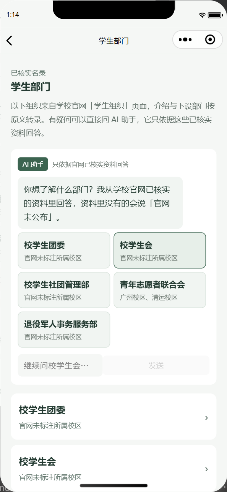
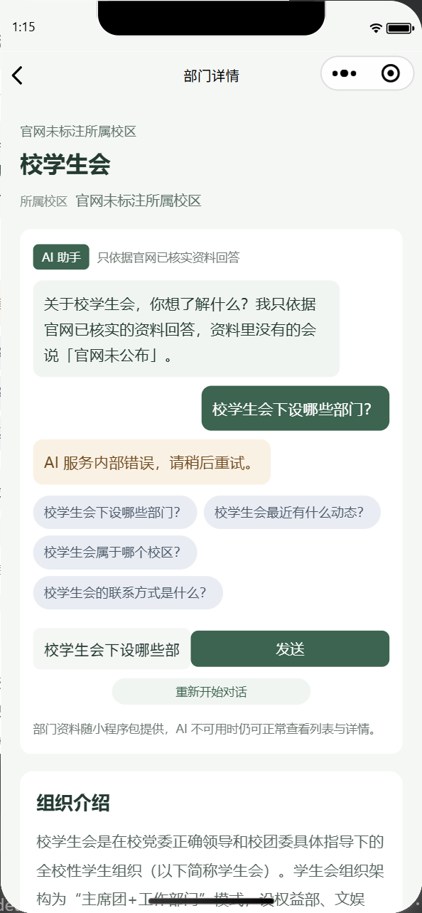
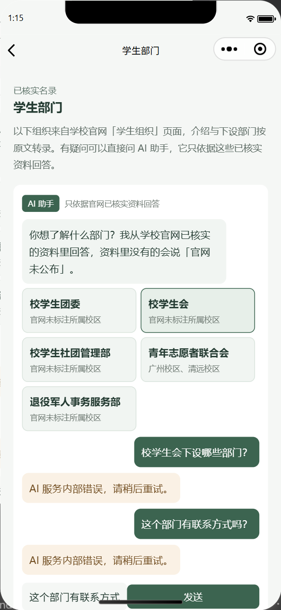

# Ticket 07 验证记录：部门 AI 问答

日期：2026-09-19（北京时间；`verification.json` 里的 `verifiedAt` 是 UTC 时间戳）。状态：**本地实现与开发者工具三条路径验收通过；真实模型回答未验证**——`ai` 云函数已部署，但模型环境变量还没配，追问只能拿到降级的失败提示。

对应 [Ticket 07](../../tasks/tickets/07-department-ai-qa.md)。服务端（模型调用、内容安全、用量与成本上限）属 [Ticket 01](../../tasks/tickets/01-ai-foundation.md)，本文只记录 07 的范围。

## 环境

- Windows，Node.js 24.21.0。
- 微信开发者工具 2.02.2608070；使用项目真实 AppID，非游客模式。
- 基础库 3.17.2；模拟设备 iPhone 12/13 (Pro)，`realDevice: false`。
- 云函数 `ai`：**已部署且可调用**（本次验收顺带确认，见「顺带取得的云端观测」）；`AI_BASE_URL` / `AI_API_KEY` / `AI_MODEL` 未配置。

## 步骤

```powershell
npm run typecheck
npm test
& 'D:\微信web开发者工具\cli.bat' auto --project '<仓库>/dist' --auto-port 9420
npm run verify:wechat
```

## 结果

- `npm run typecheck`：通过（小程序与云函数两份配置）。
- `npm test`：**228 项全过**，本票新增 17 项（`tests/departments-qa.test.cjs`）：提示词与调用契约、历史裁剪、防幻觉守卫的正例与反例、三类失败与传输层失败的文案、参数校验不发请求、按部门分开的会话与轮数上限、两个页面的编排、模板结构。
- `npm run verify:wechat`：**18 项检查全部通过**，原始结果见 [verification.json](verification.json)。本次新增 4 项：
  1. AI 对话框提示「你想了解什么部门」并列出 5 个可点选项；
  2. 点选项进入对应部门页，追问建议、输入框与回答或降级提示均可渲染；
  3. AI 不可用时部门资料区块仍在，降级提示写明资料仍可浏览；
  4. 返回列表后对话不丢，可直接继续追问。

## 截图

| 部门列表（对话框 + 选项） | 追问后的部门页 | 返回列表后继续追问 |
| --- | --- | --- |
|  |  |  |

截图核对：列表页顶部是「AI 助手」气泡（提示选择部门并说明资料里没有的会说「官网未公布」）与 5 个组织选项（对话中的那个高亮）；点选项进入校学生会页面后，气泡下方是 4 条追问建议、输入框与「重新开始对话」；返回列表后两条问答仍在，可以在列表页直接接着问。三张截图里的回答位置显示的都是降级提示「AI 服务内部错误，请稍后重试。」，下方一行「部门资料随小程序包提供，AI 不可用时仍可正常查看列表与详情。」。

## 顺带取得的云端观测（供 Ticket 01 回填，不替代该票的人工步骤）

本次验收从开发者工具直接调 `ai` 云函数取回完整返回，属 Ticket 07 的副产物：

- `{"action":"chat"}` 返回 `ok:false`、`failureClass:"internal"`，`detail` 写明「AI 服务未配置：缺少云函数环境变量 AI_BASE_URL、AI_API_KEY、AI_MODEL」。→ **函数已部署、可从小程序端调用**；Ticket 01 的人工步骤 B（配置环境变量）未完成，所以没有真实回答。
- 同一次返回里 `safety` 为：`{"provider":"wechat","api":"security.msgSecCheck","passed":true,"checked":true,"detail":"v2（scene=1）｜errcode=0｜errmsg=openapi.security.msgSecCheck:ok｜suggest=pass｜label=100"}`。→ **未认证小程序下微信文字内容安全云调用可用**，且本票的追问内容确实过了检测（`checked: true`，不是跳过）。这条只覆盖 `security.msgSecCheck`；`security.imgSecCheck` 与正式探测动作（`{"action":"probe"}`）仍未执行，[云开发文档](../../cloud-development.md) 的探测记录表仍待回填。
- `{"action":"usage"}` 返回 `ok:true`，当月 `capYuan` 50、`warnThresholdYuan` 40。→ 用量集合与上限判定可用。本次累计 14 次调用、0 token、0 元，均为内容安全子调用（模型调用从未发生）。

## 未覆盖（不要当成已验证）

- **真实模型回答**：模型密钥未配置，开发者工具里只验证了「追问发出 → 拿到分类失败 → 明确告知 → 资料照常展示」。回答与资料一致、回答带依据行两条只有桩测试覆盖。
- **防幻觉评估**：10 题评估表见 [department-qa-eval.md](department-qa-eval.md)，**未执行**；「防幻觉 100%」这条达标线目前只有确定性守卫的单元测试支撑，没有真实模型的判定记录。
- **内容安全对模型输出**：输入侧已实测经过微信检测；输出侧（`AI_MODERATE_OUTPUT`）要等模型真正返回内容才能验证。
- **真机**：未执行，`realDevice: false`。
- **长对话**：每部门 20 条气泡（10 轮）上限与「较早的对话已省略」只有桩测试覆盖，未在工具里聊满。
- 自动化断言基于元素选择器，不能替代人工对视觉与文案的复核。

## 本次实现与验收中发现并处理的问题

1. **开发者工具缓存模板文件的编译产物**：`pages/departments/qa.wxml` 是列表页与详情页共用的 `<template>` 文件，`npm run build` 后热重载不会重新编译它——新加的 `qa-answer` 标记一直不出现，验收脚本因此等不到气泡（页面表现正常，只是选择器命中不了）。**重启开发者工具后正常**。以后再改共用模板，验收前要重启工具。
2. **两次验收之间小程序不重启，模块级会话保留**：上一次运行的对话还在，按绝对下标找气泡会读到旧内容（曾经把「正在回答」当成回答）。验收脚本改为先点「重新开始对话」清空，再按助手气泡数量增量判定。
3. **「正在回答」气泡与回答气泡同类**：两者都带 `qa-row-assistant`，计数会提前命中。模板给真正的回答/提示行加了 `qa-answer` 标记，并加了测试锁住这个标记，避免验收脚本数错。

## 工具注意事项（在 Ticket 02 记录的基础上补充）

服务端口的开启路径与 [Ticket 02 验证记录](../p3-2/README.md) 相同（关闭工具 → 写 `Default/.ide-status` 为 `On` → 在 `WeappLocalData/localstorage_*.json` 里把 `security.enableServicePort` 置为 `true` → `cli.bat auto --project <仓库>/dist --auto-port 9420`）。本次补充两点：

- **工具退出时会把 `security.enableServicePort` 写回 `false`**，所以每次拉起前都要重新置为 `true`，不能只做一次。
- **`Default/.ide` 里残留的端口号会让 CLI 去连已关闭的旧端口**（报「IDE may already started at port xxxxx」或「wait IDE port timeout」）。删除该文件后重新拉起即可；它会在成功启动时重新写入。
