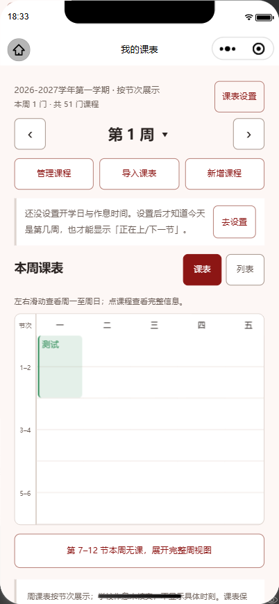
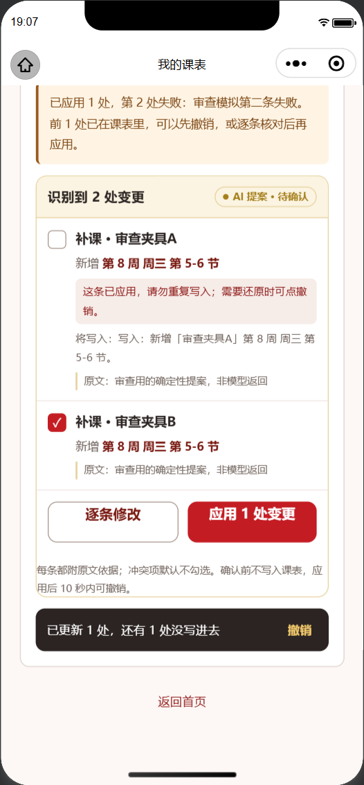
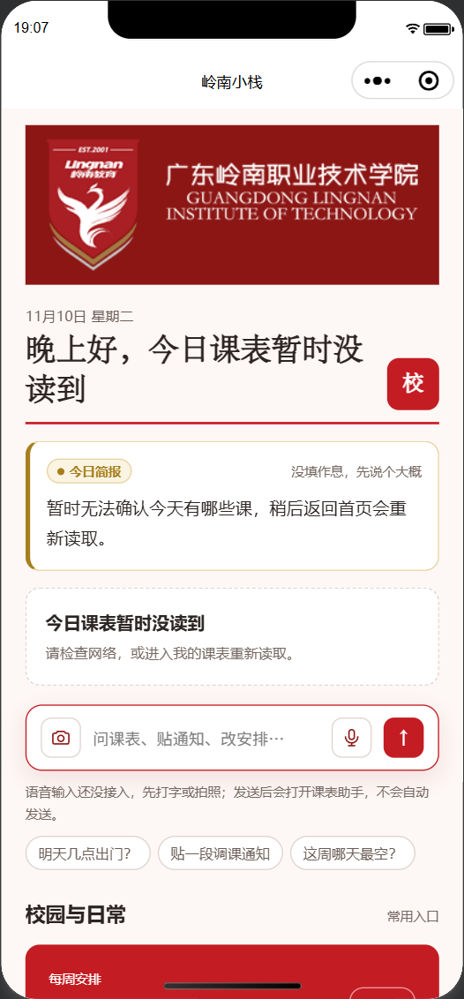
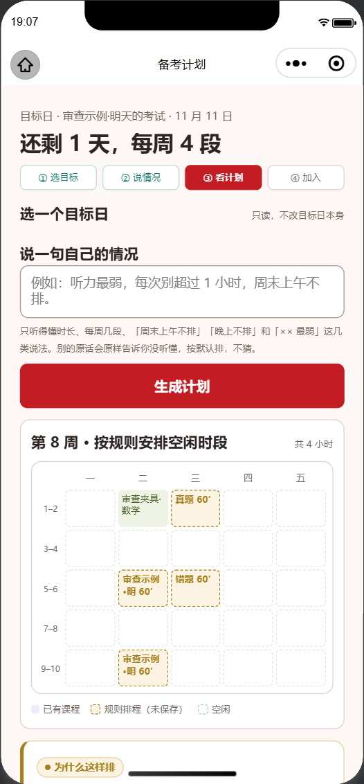
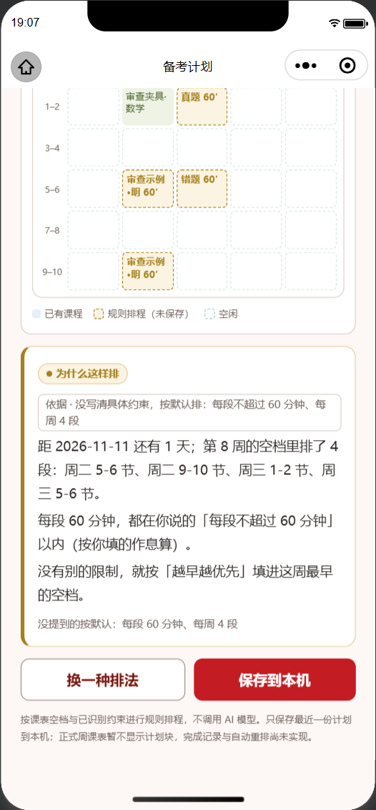

# 58 分反馈后的代码与产品体验复查

11-11续办完成：限定周次调课、计划重开和对应周列表已实现，云函数已部署；撤销平台约束已修复并完成一个真实AI样例，见[最终证据](../evidence/notice-plan-loop-2026-11-10/README.md)。下文缺口描述保留复查时状态。

日期：2026-11-10。检查基线：`70f5e3f...18beaa6` 的新增功能，以及本轮工作区修复。负责人选择：**先修功能和误导文案，保留现有首页布局；首页改版只保留设计建议。**

截图中的总分为 58，评语认可 AI 创建、修改课表，同时指出校园产品同质化、建议增加 AI 功能和优化界面。截图没有单项分，不能据此计算各模块扣分或预测改后分数。

## 主要判断

这次通知调课的方向有价值，但“新增四项功能”不等于“新增四项 AI 能力”。真正值得做深的是：读懂一段通知，定位它影响的课程和周次，让学生核对变化，然后可靠地应用、撤销。规则能完成的日期和冲突计算继续交给规则。

| 新增项 | 本轮查到的实现 | 参赛时怎样说明 |
| --- | --- | --- |
| 通知一键调课 | 调用模型生成结构化提案，端上校验、确认后逐条写入 | 属于产品内 AI；本轮没有新增真实模型效果评测 |
| 今日简报 | 从课表、作息、目标日生成规则文字和时间线 | 是实用的产品体验改进，不算新增模型能力 |
| 目标倒排计划 | 有限正则理解几类约束，规则寻找本周空档，只存本机 | 已去掉 AI 标签，改称规则排程；尚未形成保存后查看、完成反馈和课表叠加的完整闭环 |
| 语音提问 | 麦克风入口只弹“暂未接入”提示 | 尚未实现语音识别，不能作为完成的创新点 |

## 已修复：先复现，再修代码

新增 `tests/ai-innovation-review.test.cjs`，11 个案例先失败，修复后全部通过。

| 问题 | 修复后行为 |
| --- | --- |
| 同课“停一周＋改地点”后一步覆盖前一步 | 写入计划维护递进课程快照；后续变更保留先前结果，撤销快照按步骤对应 |
| 批量部分成功后重试重复加课，覆盖旧撤销记录 | 成功项取消勾选并阻止重复应用；重试只处理剩余项，同批撤销记录保留 |
| 连续点应用发出两组写入 | 写入和撤销期间拒绝重复操作 |
| 撤销部分失败后重放已经成功的逆操作 | 按倒序逐步撤销，失败就停，只保留未完成步骤，避免同课状态被错误还原 |
| “仅第12周改教室/改时间”扩大成所有周次 | 当前不支持按周拆分，明确阻塞此类提案；提示词保留时间限定，不再让模型丢掉它 |
| 周中生成计划却排到昨天，或排到目标日之后 | 本周只安排今天到目标日范围内的日期 |
| 今日已过时段仍被安排 | 页面传入北京时间；今日时段必须能用作息核实尚未开始，时刻未知则从明天安排 |
| “周末上午可以排，晚上不排”串用否定词 | 按子句识别排除约束，避免把肯定句反转 |
| 只填早课作息，却说时刻未知的晚课“已经上完” | 今日课程起止时刻不齐时保留未知，不宣布全部结束 |
| 重叠课程中短课下课被误认为空档 | 空档起点取所有前序课程的最晚结束时间 |
| 首页课表读取失败等同“今天没有课” | 简报和时间线空态区分读取中、读取失败、成功但无课 |

页面事实修正已执行：入口“AI 排计划”改为“排学习计划”，图例写“规则排程”，按钮与成功提示写“保存到本机”，移除“已加入正式课表”“每周日晚自动重排”的承诺。保留原页面布局。

代码规范轴发现的主要问题是同课快照、失败重试和限定范围三个数据问题；功能规格轴发现的主要问题是日期窗口、计划闭环缺失、未知状态误判和否定范围。两轴结论分别核对，测试通过不代替 AI 效果或用户体验验证。

## 本轮走查步骤与截图

1. **打开首页：需要继续优化。** 本轮真实只读截图中，大校徽、简报、完整时间线占据首屏，问 AI 入口在下方。未设置开学日时会按星期展示多周课程候选，不能把“10节”当作已核实的当天课程数量。小字偏多，长时间线使核心入口更难发现。

   

2. **进入课表：功能可达，初始设置有摩擦。** 缺开学日时默认周数不代表当前教学周；设置提示是诚实的，但评委仍要先理解周次、作息，再找到 AI 操作。建议未来将初次设置与“看示例”引导放到清晰的一步，不伪造用户数据。

   

3. **通知提案部分成功、重试、撤销：修复后通过。** 原生页面由确定性提案与内存云函数夹具驱动；第一条成功后取消勾选，第二条可重试，随后两条都能撤销。以下不是模型真实识别结果。

   

4. **首页读取失败：修复后通过。** 简报与空态均说明没读到，不再推断无课。布局按负责人选择保留。

   

5. **生成并核对计划：日期窗口和能力文案通过，保存后闭环仍待补。** 示例固定今天为周二、目标为周三，只排周二未开始和周三的时段。尚未实现正式周课表叠加、完成记录和自动重排，不再提前承诺。

   

   

可见的无障碍风险：部分辅助文字只有约11–12px、图标点击区较小、长课名换行密集。截图无法证明读屏、系统大字号、色觉差异或手机触控体验合格；本轮未执行这些测试。

## 接下来建议怎么做

**第一优先：做深单周通知调课。** 当前安全修复会阻塞限定周次的改地点/改时间。下一步可在现有课程结构中按涉及周次拆分，保留其他周次，列明“改哪一周、哪门课、前后时间地点”。先把停课、补课、移课、多条通知、信息不足和冲突这几类自然说法做可靠，比再加一个泛聊天入口更贴合已获认可的亮点。涉及整批写入、网络结果未知或跨设备同时改课的情况，还应考虑服务端幂等与并发控制；本轮端上修复不等于解决这些问题。

**第二优先：让计划保存后真正有用。** 先补保存后重开可查看、在周课表中单独显示计划、标记完成与手动重新安排。计划继续与正式课程分开，不能污染导入替换和课程统计。若要把它变成新的 AI 能力，可让模型理解学生更自由的约束、生成与目标相关的学习任务，规则排程器负责日期、时长、课程冲突和最终校验。较简单的替代是把约束改为明确选项，继续提供可靠的规则排程；它成本更低，但应按规则工具介绍。

**第三优先：让评委在第一屏找到核心能力。** [首页聚焦设计](../design/ai-review-2026-11-10/README.md)建议缩小校徽，只展示下一节/下一步，突出“贴通知生成变更”，完整时间线与校园工具收起。尚未接入的麦克风建议暂时隐藏；相机入口直接写“导入课表截图”，避免被理解成任意图片提问。本轮按负责人选择保留布局，这些尚未实施。

**演示与评测建议：** 演示围绕一段通知展开，连续展示识别、前后对照、冲突、确认、课表变化、撤销；不要用入口巡览代替结果。准备未参与开发的新通知逐条记录预期与实际课程/周次变化、澄清、耗时和费用，保留失败案例。当前没有新独立题集或用户使用结果，不能宣称创新效果、正确率或分数已经提高。

## 验证结果与边界

- 修改前：类型检查、文档检查、876 项本地测试通过。
- 修改后：11 项新增复现测试通过；全量 **887/887**，类型检查、文档检查见[本轮证据](../evidence/ai-review-2026-11-10/README.md)。
- 开发者工具：6 项关键行为检查通过，4 张修复后截图已逐张查看。云函数全由内存夹具接管；真实云写入、本机存储写入、模型调用均为0。
- 原自动化截图缩为149px，不作为评审件；最终用截图技能捕获同一前台模拟器区域，已确认画面、文案和对应步骤一致。重载初期曾运行旧缓存，重新编译后才执行本轮通过记录。
- 原生截图不是手机真机；本轮没有部署、上传、提交或重新打包参赛材料，r3包不自动包含工作区修复。
